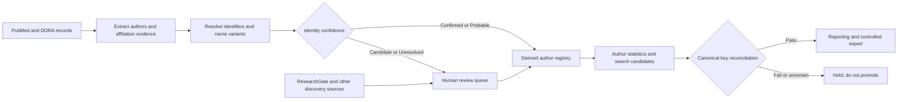

# Author-centred registry and attribution design

Status: **Design incorporated; implementation remains a derived, review-gated extension**

The publication registry remains the authoritative publication-level register. The author registry is a derived view built from source evidence and identity decisions; it must not promote name-only matches into the canonical bibliography.

## MoSCoW requirements

### Must have

- Preserve publication-to-author relationship, author order, source, and exact evidence.
- Distinguish structured author-affiliation evidence from free-text or inferred attribution.
- Store stable identifiers when available: ORCID, OpenAlex, DOI, PMID, and DORA keys.
- Use explicit identity states: `Confirmed`, `Probable`, `Candidate`, and `Unresolved`.
- Keep ambiguous names and conflicts in review rather than merging silently.
- Preserve affiliation history and source observation timestamps.
- Keep PubMed/DORA inclusion authority separate from discovery sources.
- Reconcile author-derived candidates to canonical publication key sets before release.

### Should have

- Maintain name variants, initials, co-author context, and normalized institutional hierarchy.
- Provide counts for publications, first/senior authorship, collaboration, source coverage, and provider-specific citations.
- Record DORA collection/community, item type, repository version, raw date, and deposit/update date when exposed.
- Use OpenAlex/ORCID/DOI metadata for identity resolution and ResearchGate only for discovery or corroboration.
- Provide a human review queue with source links and evidence snippets.

### Could have

- Co-author networks, topic clusters, research-field summaries, and institutional movement.
- Profile links for ResearchGate, ORCID, OpenAlex, and institutional pages.
- Candidate searches seeded from confirmed authors, quarantined until independently attributed.

### Won't have in the first release

- A claim of complete institutional author or publication coverage from DORA alone.
- Automatic inclusion based only on a name string or ResearchGate profile.
- Summed citation counts across providers.
- Unreviewed author-level performance or ranking claims.

## Evidence and source policy

| Use | Preferred evidence | Role |
| --- | --- | --- |
| Publication inclusion | PubMed and DORA affiliation/source evidence | Baseline authority |
| Author-affiliation linkage | `PubMedAuthorEvidence`, structured source author records | Strong evidence |
| Identity resolution | ORCID, OpenAlex, DOI metadata, Scopus/WoS identifiers | Resolution/corroboration |
| Repository context | DORA handle, URL, collection, item type, version/date metadata | Source context |
| Discovery | ResearchGate, Google Scholar, author webpages | Candidate generation only |

ResearchGate is not an authoritative completeness source. Profiles are user-maintained and may be incomplete, duplicated, or stale. A ResearchGate candidate retains its URL and stays `Candidate` or `Needs Review` until supported by an identifier or institutional/source evidence.

## Derived entity shape

```text
Author
  ├─ AuthorKey, DisplayName, NameVariants
  ├─ ORCID / OpenAlex / Scopus / WoS identifiers
  ├─ IdentityStatus and IdentityConfidence
  ├─ AffiliationHistory
  └─ AuthorPublicationEvidence[*]
       ├─ CanonicalKey / SourceKey, AuthorOrder, Role
       ├─ AffiliationText and AffiliationIndex
       ├─ EvidenceKind and EvidenceURL
       ├─ SourceObservedUTC
       └─ ReviewStatus / ReviewNotes
```

## Mermaid: evidence and review flow



## Current gaps to retain explicitly

- DORA historical completeness and collection coverage remain unverified.
- DORA dates may be repository/deposit dates rather than formal publication dates.
- DORA records may be reports, manuscripts, theses, conference items, or repository versions.
- DORA author-to-affiliation linkage may be text-only and is not equivalent to PubMed structured author evidence.
- DOI/PMID absence requires stable DORA identity and conservative matching.
- Version, duplicate, withdrawn, and revised-record relationships need explicit fields before counting.
- The current SharePoint publication list is not itself an author entity store; this is a derived extension.

## Initial statistics contract

Author statistics must be filterable by `ReviewStatus`, `IdentityStatus`, source, observation period, and attribution evidence. Counts must expose denominators and unknowns; citation measures remain provider-specific and timestamped.
