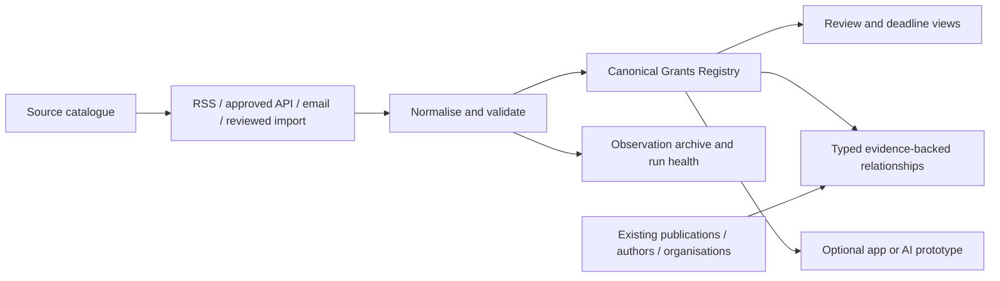

# Grants delivery review and source map

Baseline research date: 2026-09-20. Official-route checks are dated inline through 2026-10-23. This is a researched implementation proposal, not a deployment receipt. E06 exists; the previously discussed E06-P1–P7 tracks have not been created as individual Conductor tracks. Sources below were identified through official pages; an identified page is not a tested RSS/Atom/API endpoint. Coverage is non-exhaustive.

## Simpler implementation and reuse

Start with one Grants Registry list, a source register (initially configuration), and evidence files in the existing approved archive. Introduce a relationship list only when publication links are delivered. Reuse the publication design's stable keys, review preservation, date uncertainty, archive manifests, UI automation and readback conventions. Keep publication and grants flow identities separate. A single canonical ingestion workflow may have small adapters; it need not be one unmaintainable flow.

Reuse `scripts/grants_registry.py` and `tests/test_grants_registry.py` after hardening. Inspection found key generation occurs before lowercase/link aliases are normalised, partial dates are not calendar-validated, and merged observations retain hashes but not the full changed values. These require regression cases before deployment. RSS/Atom-shaped dictionaries are supported; XML fetching/parsing is not implemented.

Review `scripts/build_sharepoint_upsert_package.py` before adapting it: it changes the trigger to recurrence, hardcodes target identifiers and field mappings, and uses `item()` in top-level upsert actions. Its current string-based validator does not establish that the action graph is executable. Reuse patterns and tests, not an unverified ZIP verbatim. Existing `field_N` names may be legitimate internal names: discover and map them, do not blindly rename columns.

Reuse author and organisation keys only with supported evidence. The current organisation helper includes generic aliases such as Community Health and defaults validity dates to a build date. Correct these before reusing its output as confirmed institutional affiliation. An organisation chart is not a strict facility-below-service tree: services can span facilities. No workforce row data is needed.

Separate Opportunity, Award, and Application identities. An opportunity can lead to awards; publications can acknowledge awards. A topical match between a paper and an opportunity is a recommendation, not evidence of funding. Use relationship types such as `funded_by_award`, `relevant_to_opportunity`, and `investigator_affiliation`, with source, review state and confidence. Exact funder plus award identifiers support confirmed links; similarity supports review candidates only.

Add scheme/round identity; funder versus administering agency; deadline type (EOI, minimum data, internal, final); raw local timestamp and timezone; amount bounds/currency; source-stated and calculated status separately; eligibility conditions; last checked; source health. Preserve archived rounds and changes. Do not make every field mandatory before the first useful release.

## Delivery tranches and proposed tracks

| Tranche | Proposed track | Reviewable outcome and acceptance | Dependency/fallback |
|---|---|---|---|
| 0 | G01 contracts and fixtures | Harden keys, rounds, dates, merge history; test alias-equivalent records, impossible dates, repeated rounds, changed deadlines and review preservation | Local; no tenant dependency |
| 0 | G02 source catalogue | Source ID, authority, URL, access method, coverage, eligibility scope, health, last verification and sample fixture for each source | Manual entry/import available for sources without a verified feed |
| 1 | G03 canonical list and review views | Discover existing objects; additive schema; indexed unique key; create/replay/update readback; Needs Review/Open/Closing/Queensland views | Tenant access and list permissions; local package remains usable if access unavailable |
| 1 | G04 federal and Queensland intake | One controlled cycle for NHMRC/MRFF/ARC/QH and priority Queensland sources; source failures isolated; changed dates retained | Email or reviewed CSV where API/RSS unavailable; no requirement to scrape |
| 2 | G05 university and specialty coverage | JCU/UQ/QUT/Griffith adapters or assisted intake; distinguish internal deadlines and affiliated-applicant rules | Restricted portals affect only that adapter |
| 2 | G06 publication relationships | Evidence-backed award links and separately labelled opportunity relevance; counts unchanged | Works initially with publication keys without author matching |
| 3 | G07 operational acceptance | Two successful cycles, duplicate/concurrency and failure tests, source health, rollback, exact key readback | Scheduling and outgoing notifications remain disabled/deferred wherever existing authority does not cover the exact action; do not seek approval or contact anyone |
| 4 | G08 optional app and AI experiments | List-backed app prototype; grounded summaries assessed against fixtures; source links and human review | Preview, AI and premium availability never required for base registry |

For a smaller implementation model, each task should name exact input/output files, one expected behaviour, fixtures, commands, expected result and rollback. Separate read-only discovery, local generation, controlled write and readback tasks. Parallelise source research/adapters with disjoint files; use one coordinator for schema changes and platform writes.

## Source catalogue: discovery evidence and intake proposals

The reviewed source catalogue is machine-readable at `config/grants-sources.json` and validated by `scripts/grants_sources.py`. Each route records authority URL, proposed intake, eligibility scope, last verification date, health state, and a dated qualification status with per-field evidence references. Record identity and program/scheme/round semantics are separate qualification fields. The `access` field records public, already-authorized, restricted, unavailable, unresolved or not-applicable access; the `reuse_terms` field records permitted, restricted, not-permitted, unresolved or not-applicable reuse. Opportunity admission requires verified evidence for every field, public or already-authorized access, and an explicit permitted reuse decision. These are source-discovery/configuration assertions; they do not prove that the listed pages expose a permitted RSS/Atom/API endpoint.

### G02-H01 source disposition (reconciled 2026-09-24)

The maintained catalogue contains four machine routes: ARC NCGP award context, RGS award context, Queensland catalogue metadata and QGIP opportunity candidates. None is admitted as an unattended canonical opportunity source. Its `last_verified` is the bounded sample date, not ongoing source health. The other official references remain discovery or reviewed-import candidates outside the automated catalogue. An HTML page's HTTP 200 establishes neither an opportunity record nor a right to automate collection. For all rows without a proven record key, the key path is **unverified**; no title, URL slug or inferred round is substituted. Public-page access establishes no reuse licence, and each candidate still needs its access, terms and permitted export route checked before use.

Per-source structured qualification is retained in the catalogue. All four rows separately reference bounded-sample evidence; this confirms only sampled response shape, not complete pagination or opportunity eligibility. The focused catalogue and ingestion checks validate the required field at both admission boundaries. ARC has verified access/schema/paging/replay, partial record identity/entity mapping, unverified round/lifecycle semantics and unresolved reuse. RGS has verified access/schema, partial pagination/identity/round/lifecycle/entity mapping, and unresolved replay/reuse. Grants Finder is verified for public access, package schema and metadata identity, with pagination/replay/round/lifecycle not applicable and reuse unresolved. QGIP has verified access/schema/paging/replay and permitted CC-BY reuse, partial record identity/entity mapping, and unverified round/lifecycle semantics. These statuses do not change their entity classes or admission decisions.

| Official authority and route | Entity / stable key | Observed access and date | Decision and next evidence |
|---|---|---|---|
| ARC, official grants data API | Award context; `data[].id` observed as the API record ID; `attributes.code` retained as `AwardCode` and documented static by ARC | Public JSON API bounded sample, 2026-09-22; native read-only action 2026-09-22; official API help checked 2026-10-07; copyright guidance rechecked 2026-10-23 | `context_only`; keep awards distinct from opportunities. ARC documents JSON API pagination up to 1,000 rows/page and current post-award fields, but does not establish cross-snapshot ID stability, deletion/replay semantics or a separate API-data licence for RIMS. ARC's general website licence is CC BY-NC-ND 4.0 unless otherwise stated; the grants-dataset page does not state whether that licence applies to API records. Keep reuse/transform rights unqualified. G02-H02 remains open. |
| ARC Research Grants Services (RGS) Grants Search API | Initiated-grant context; bounded 2026-10-23 sample had `data[].id == attributes.code`; official help marks `code`, program, scheme, submission year and scheme-information static, while funding, grantee, investigators, status and anticipated end date are current | Official [RGS API help](https://dataportal.arc.gov.au/RGS/Web/Grants/Help) and live page-1 API read on 2026-10-23; HTTP 200, one-record response, `total-size=34,963`, `total-pages=34,963` at page size 1; official lifecycle/copyright help rechecked 2026-10-23 | Disabled `context_only` catalogue candidate. RGS covers ARC and other entities' grants only after initiation; its help defines Active/Closed status and Closed as completed/acquitted or relinquished, and documents JSON pagination (maximum 1,000) plus detail links. The one-record sample is not full-snapshot proof. Stable-ID guarantees, withdrawal/deletion treatment and permitted reuse remain unverified; the RGS page footer says © ARC, All Rights Reserved. No full crawl or row retention was performed. It cannot satisfy opportunity coverage. |
| ARDC Research Activities API | Aggregated grant/program/project metadata; route documented, no current G02 key/response captured | [Official API guide](https://documentation.ardc.edu.au/rda/research-activities-api) and [RDA metadata-consumer terms](https://documentation.ardc.edu.au/rda/research-data-australia-service-schedule-for-metad) rechecked 2026-10-23 | Conditional only. API requires a registered key; metadata consumer terms require prior written agreement from ARDC before reuse in any product or service. Do not retrieve or reuse for G02 unless the applicable existing key and agreement are already evidenced. No new key or agreement request; no G02 API call. Not an opportunity authority. |
| Health Data Australia (HDA) | Health dataset descriptions and discovery metadata; not grants or opportunities | Official [HDA documentation](https://documentation.ardc.edu.au/hda) and [overview](https://researchdata.edu.au/health/about) checked 2026-10-23 | Metadata-only scope disposition. HDA publishes dataset descriptions and may link to funding and study records; underlying data stays with custodians, who receive access requests for separate consideration. No HDA metadata was queried or retained, no access request was made, and the checked guides establish no machine-harvest contract. Exclude from grant opportunity coverage. |
| Queensland Government, Grants Finder CKAN `package_show` API | Source-catalogue metadata; `result.id`, prefix `qld-ckan-package:` | Public JSON package sample, 2026-09-22; native read-only action 2026-09-22 | `metadata_only`; one package resource is not an opportunity feed. Follow actual administering authorities for calls. |
| GrantConnect, official portal and candidate RSS | Opportunity authority; Finance identifies GO ID as a unique opportunity identifier, but machine-field mapping unverified | Portal HTTP 403 on 2026-09-20; candidate RSS GET HTTP 403 on 2026-09-22. Finance's current [Find a grant](https://www.finance.gov.au/individuals/find-grant-grantconnect) page rechecked 2026-10-23 and [GrantConnect requirements](https://www.finance.gov.au/government/commonwealth-grants/changes-commonwealth-grants-framework-2024/grantconnect-requirements) rechecked 2026-10-23 (page dated 2026-10-20) | Not admitted. The current public guidance describes the portal, applicant notifications and publication requirements, but does not document an opportunity API/feed/export contract or reuse terms. Keep the CSV notification route as a possible reviewed-import input only; build no collector unless public authoritative documentation establishes the interface and lifecycle contract. A 403 is not a permanent source verdict. No contact or response request will be made. |
| NHMRC, official funding calendar | Opportunity/round candidate; key unverified | [Find funding](https://www.nhmrc.gov.au/funding/find-funding) and [funding schemes and calendar](https://www.nhmrc.gov.au/funding/calendar) rechecked 2026-10-23. The pages list open/upcoming/recently closed schemes and application dates; the calendar says dates are planning estimates. No API/RSS/CSV/export contract is documented on these pages. | Human-reviewed discovery only. Preserve page observation time and the source-stated date caveat; verify a specific call and its official documentation before import. This page check does not prove that no separate machine interface exists. Historical 13 HTML rows are not admitted source records. |
| Australian Department of Health, Disability and Ageing, MRFF calendar/newsletter | Opportunity/round candidate; key unverified | [Official MRFF grant opportunities calendar](https://www.health.gov.au/our-work/mrff/grant-opportunities-calendar) rechecked 2026-10-23: current-opportunity table is as of 2026-09-30, and the page was last updated 2026-10-02; it links current opportunities and notification registration to GrantConnect. The newsletter/subscription pages remain email channels. | Human-reviewed discovery only. Preserve the table's 2026-09-30 source vintage; do not treat check date as source freshness. No API/RSS/CSV/export contract is documented on the checked page, which does not prove no separate machine interface exists. Do not scrape calendar/news pages or treat award workbooks as opportunities. Historical 179 HTML rows remain non-admitted. |

### Federal award-data versus opportunity-source boundary — 2026-10-23

The official [NHMRC research funding statistics and data page](https://www.nhmrc.gov.au/funding/outcomes-and-data-research/research-funding-statistics-and-data) says its datasets are updated annually to include new awards and refresh continuing-grant data; the published snapshot was last updated 2026-03-25. NHMRC's [accountability and reporting page](https://www.nhmrc.gov.au/about-us/accountability-and-reporting) says grants awarded by NHMRC are published on GrantConnect within 21 days of the agreement taking effect, may be revised there, and are also published on the NHMRC website. This supports treating NHMRC workbook downloads as dated award snapshots and GrantConnect as the opportunity publication route; it does not establish a machine contract for current opportunities or grant records beyond the published snapshots.

The Department's [MRFF funding statistics dashboard](https://www.health.gov.au/our-work/mrff/about/medical-research-future-fund-funding-statistics-dashboard) says it refreshes when recipient outcomes are published, excludes outcomes under media embargo, and licenses material on that webpage under CC BY 4.0 subject to stated exclusions. This is outcome-statistics context, not an opportunity feed or a licence statement for every workbook/resource. Keep the MRFF opportunity calendar, recipient workbooks and statistics dashboard as distinct source classes; retain the calendar's own as-of date and workbook publication vintage. No opportunity route or admission changed.
| Queensland Health, ORI grants support and 2026 research calls | Local opportunity/round candidate; key unverified | Official [Research grants and support](https://www.health.qld.gov.au/research-reports/research/researchers/grants-support) page checked 2026-10-23, updated 2026-10-16; [Clinical Research Capacity Building Grants 2026](https://www.health.qld.gov.au/research-reports/research/researchers/grants-support/clinical-research-capacity-building) and [Genomics Research Grant 2026](https://www.health.qld.gov.au/research-reports/research/researchers/grants-support/queensland-health-genomics-research-grant-2026) pages checked 2026-10-23, both list applications closing 2026-12-07 | Official HTML discovery/reviewed-import only. The checked pages document no RSS/Atom/API/export contract or reuse terms. Verify applicant scope and source terms before any reviewed import; no rows imported. |
| Queensland Health, Health Practitioner Research Scheme | Restricted opportunity candidate; key unverified | Official [HPRS](https://www.health.qld.gov.au/hpresearch/html/grants) page checked 2026-10-23, updated 2026-10-09; 2027 round closed | Reviewed import only if a current round is published; verify CHHHS practitioner eligibility and reuse terms for that round. No machine route established. |
| Cairns and Hinterland HHS, research grants hub | Local discovery hub; no record key | Authority page HTTP 403 on 2026-09-20 | Discovery only. Follow the administering funder and official round; do not turn hub links into opportunities. |
| Far North Queensland Hospital Foundation | Award/news context; no opportunity key | Official page HTTP 200 on 2026-09-20 | Context only for that page; find and verify a current official call before reviewed import. |
| Emergency Medicine Foundation, Queensland grants | Official calendar now lists Queensland Research Program Rounds 47 and 48 with scheme names, opening dates and separate closing dates; a proposed reviewed-import identity can combine the publisher's round number and scheme, but no publisher API ID or cross-round lifecycle contract is documented | [Official grants calendar](https://emergencyfoundation.org.au/grants/calendar/) rechecked 2026-10-23; Round 47 opens 2027-01-25 and Round 48 opens 2027-06-07 | Reviewed-import candidate only. Preserve the exact calendar observation and source link; do not promote this human-facing page to a machine feed or infer eligibility from the round listing. The existing importer can carry a reviewed round/scheme identity once a human review exists. No records were imported or judged in this source check. |
| Advance Queensland, newsletter/programme pages | Discovery and possible opportunity rounds; key unverified | Authority page HTTP 403 on 2026-09-20 | Discovery only; a newsletter is not a machine feed. Follow official programme calls and assess permitted export. |
| Cancer Council Queensland, research centre | Programme/discovery context; key unverified | Official HTML page HTTP 200 on 2026-09-20 | Discovery only until an open round, permitted source and eligibility are verified. |
| Metro North and Metro South HHS, research grants pages | Institution-restricted opportunity candidates; keys unverified | Metro North [grants hub](https://metronorth.health.qld.gov.au/research/support/grants) and human-curated [Chance for Grants](https://metronorth.health.qld.gov.au/research/support/grants/chance-grants) checked 2026-10-23; Metro South [INNOVATE Grants](https://metrosouth.health.qld.gov.au/research/research-grants/innovate-grants) checked 2026-10-23, open 2026-10-06 to 2026-11-20; Metro South Research Support Scheme close date 2026-07-27 has elapsed | Reviewed-import/discovery only. The Metro North table is HTML and no documented machine contract or reuse terms were found on the checked pages. Metro South calls state local employment eligibility; do not infer CHHHS eligibility. No rows imported and no endpoint added. |
| Torres and Cape HHS, research support | Regional discovery; key unverified | Official HTML page HTTP 200 on 2026-09-20 | Discovery only until administering authority, current call and eligibility are verified. |
| Queensland Government, award-recipient data | Award-context candidate; key unverified | Dataset reference listed; no resource/API row readback in current catalogue | Not admitted. Inspect official resource format, identifier and terms before any award-context adapter. |
| Queensland Government Open Data, bounded CKAN funding-source discovery | Historical/direct funding metadata; no opportunity record key | Official CKAN `package_search` API queried 2026-10-23 for `research` (175 matches, fetched as 100 + 75), `research funding` (19), `research grant` (10), `funding opportunities` (17), `health research funding` (54), `medical research grants` (16) and `clinical research grants` (10); five relevant metadata records were checked via `package_show` | No release-suitable research opportunity source found in these results. The `research` results included research-activity and R&D-expenditure datasets, not current calls. The [DAFF Agri-Science funding-source metadata](https://www.data.qld.gov.au/api/3/action/package_show?id=daff-agri-science-queensland-research-development-and-extension-funding-sources) describes a 2008–2013 funding breakdown; [Non Competitive Funding Initiatives](https://www.data.qld.gov.au/api/3/action/package_show?id=non-competitive-funding-initiatives) describes one-off direct awards for physical-activity initiatives. [Active Industry Fund](https://www.data.qld.gov.au/api/3/action/package_show?id=active-industry-fund) and [Active Industry Project Fund](https://www.data.qld.gov.au/api/3/action/package_show?id=active-industry-project-fund) metadata describes funding for sport/active-recreation organisations and round-labelled XLSX resources. These are outside this research-opportunity intake; resource files were not read or retained, no catalogue entry was added, and CKAN search does not establish that no other package exists. |
| Queensland Health grant funding recipients | Historical awarded-recipient context; not opportunities | Official CKAN [`package_show`](https://www.data.qld.gov.au/api/3/action/package_show?id=queensland-health-grant-funding-recipients) metadata checked 2026-10-23: metadata modified 2021-11-01; the only resource is 2012–2013 recipients, last modified 2013-12-12; CC BY 3.0 | Context-only historical award source if ever selected; too stale and entity coverage too broad to meet current research-opportunity intake. Resource rows were not read or retained, and no adapter or catalogue entry was added. |
| Health Translation Queensland | Aggregator/discovery candidate; key unverified | Official funding-opportunities page; conventional `/wp-json/`, WordPress search API, and `/feed/` GET probes returned 404 on 2026-09-28; no documented machine endpoint or row-key readback | Discovery only. The 404s do not prove other interfaces are absent. Reconcile any listed opportunity with its administering authority before reviewed import. Private route probe: `private/ops/2026-09-28-healthtranslationqld-machine-route-probe-private.json`. |

The 2026-09-20 authority-probe receipt is `private/ops/2026-09-20-grants-source-probe-current.json`; the API and native readback receipts are `private/ops/2026-09-20-queensland-grants-finder-api-readback.json` and `private/ops/2026-09-23-funding-machine-endpoint-action-readback.json`. These ignored files carry operational detail; the public matrix contains only classifications. University and specialty routes remain in G05. G02-H02 and G04 must establish permitted machine reconciliation or a reviewed-import row before any opportunity coverage claim.

### G02-H02 source readback update — 2026-09-25

The Queensland Grants Finder package index resolves Queensland Health (`QH`) to the separate QGIP package and `Current program funding` resource (`03db77e8-d6af-46db-8c39-724d4c8c140c`). The official CKAN datastore reports an exact total of 400 rows (`total_was_estimated=false`), paged in four groups of 100. The current snapshot has populated, unique `Service ID` values; `_id` is an ordinal and is not used as identity. The package declares CC-BY-3.0 and its resource metadata was updated 2026-02-11. The catalogue is annual/stale-prone, and public metadata does not document immutable Service ID semantics, change/deletion events, or a delta feed.

Local adapter `scripts/grants_qld_qgip_api.py` rechecks the resource metadata around its bounded page read, requires exact count and contiguous complete pages, rejects missing/colliding Service IDs, and emits only rows with explicit `Status=Open` and an assistance type containing `Grant`. Those rows are typed `OpportunityCandidate`, always `Needs Review`, carry source timestamp/hash, and have no canonical OpportunityKey. The source catalogue uses `candidate_only`; canonical `scripts/grants_ingestion.py` still accepts only `opportunity`/`opportunity` rows. This is a review queue bootstrap, not accepted opportunity coverage or a proven stable-key reconciliation. Dated snapshots now establish observed continuity; public identity/lifecycle semantics remain open before canonical intake.

2026-10-23 official recheck: the [QH resource metadata page](https://www.data.qld.gov.au/dataset/qh-queensland-government-investment-portal-qgip/resource/03db77e8-d6af-46db-8c39-724d4c8c140c) still declares CC BY 3.0, annual updates and a data/metadata update date of 11 February 2026; its 41 text fields include `Service ID` but provide no identifier or lifecycle definition. The saved page receipt is `private/ops/2026-10-23-g02-qgip-official-resource-recheck/receipt.json`. A new complete two-pass API snapshot on 23 October returned 400 rows and six review candidates; its ordered digest and all per-Service-ID raw/business hashes match the complete 16 October snapshot, with zero additions, removals, content changes or candidate transitions. Private comparison evidence is `private/ops/2026-10-23-g02-qgip-official-resource-recheck/snapshot-comparison.json`. This extends observed continuity, not identity or deletion semantics; no candidate was admitted.

2026-10-23 qualification disposition: the current official QH dataset page describes the resource as current-financial-year program funding, machine-readable CSV, and annually updated; the resource page identifies CC BY 3.0, a 2026-02-11 data vintage and a text `Service ID` field. It does not define whether that ID is immutable, distinguish program from application round, or document reopening, closure/deletion events or a canonical grants-model mapping. The October snapshots establish repeat-read continuity only. QGIP therefore remains `candidate_only`. No existing, evidenced reviewed opportunity batch was found among the current GrantConnect, NHMRC, MRFF, Queensland Health or local discovery records: their retained evidence lacks at least source-specific reuse authority, stable row/round identity, lifecycle evidence, or an actual reviewed batch receipt. Recheck QGIP after a new official resource publication or public documentation defining those semantics; recheck the other routes when new public authoritative documentation or an already-authorized source file with row-level review evidence is available. No source is admitted and no reviewed batch is ready for G04-H03.
The command-line adapter prints help without network access by default; use
`python3 scripts/grants_qld_qgip_api.py --fetch` to opt into its bounded read-only
snapshot. Unit tests inject the fetch function and verify the default/help paths
do not call it.

### G02-H02b dated snapshot comparison — 2026-09-28

A second complete read through the official Queensland CKAN API was captured at
`2026-09-27T14:19:01Z`, more than two days after the 25 September baseline.
Both snapshots contained 400 source rows and six review-only candidates. The
per-Service-ID source and business-content hashes matched: no additions,
removals, content changes or ordinal-only changes were detected, and the
source resource update timestamp remained unchanged. The current retrieval
and comparison receipts are
`private/ops/2026-09-28-qgip-candidate-snapshot-private.json` and
`private/ops/2026-09-28-qgip-dated-snapshot-comparison-private.json`.

No external steward response will be sought. Public metadata confirms the
publisher-declared annual update frequency and CC BY 3.0 terms, but does not
document Service ID durability, program-versus-round identity, reopening, or
closure/deletion history. Keep QGIP review-only until authoritative public
documentation establishes those semantics and the canonical mapping.

This establishes persistence across two dated observations only. It does not
prove that Service ID is immutable, identifies a scheme/round, or carries
authoritative closure/deletion semantics; the source is still an annual
catalogue with unchanged February metadata. Rows remain review-only, and the
G02-H02b requirement for publicly documented lifecycle semantics and a
canonical key mapping is open. No tenant write or opportunity admission was made.

### G02-H02b fourth dated snapshot — 2026-10-03

The existing adapter performed a fresh, complete, read-only read through the
official Queensland CKAN API at `2026-10-02T15:59:41Z`. Two complete 400-row
page passes matched within the request; package/resource/schema and the Grants
Finder QH pointer were rechecked before and after collection. Compared with
the complete 28 September snapshot, the ordered snapshot digest and all
per-Service-ID raw and business-content hashes are identical; six existing
open-grant review candidates are unchanged. The source reports its prior
update timestamp `2026-02-11T04:31:12.900845Z`. Receipts:
`private/ops/2026-10-03-qgip-fourth-complete-snapshot-private.json` and
`private/ops/2026-10-03-qgip-fourth-dated-snapshot-comparison-private.json`.

The current Queensland resource page exposes `Service ID` as a typed data
field, while the CKAN API guide defines package/resource IDs and schemas; these
documents do not establish Service ID's program/round identity or lifecycle
semantics. The additional dated equality strengthens observed content
continuity only. Service ID remains an unproven identity, absence is not a
tombstone, and candidates remain `Needs Review`; no canonical admission or
tenant write occurred.

A further official-API route check tested whether QH's historical 2017–18
program-funding resource could add cross-year identity evidence. The package
reports a 200-row resource with a `Service ID` field, but both complete
100-row CKAN pages contain blank/non-text values for all 200 rows. It cannot
be used to compare historical identities. This is a resource-quality finding,
not evidence that current QGIP IDs are unstable or stable. Keep the current
resource candidate-only until public authoritative documentation defines
Service ID lifecycle semantics. Bounded summary receipt:
`private/ops/2026-10-03-qgip-historical-service-id-probe-private.json`.

### Federal machine-route disposition — 2026-09-25

This is a route review, not proof that no private or authenticated interface exists. The [NHMRC funding calendar](https://www.nhmrc.gov.au/funding/calendar) and [Find funding](https://www.nhmrc.gov.au/funding/find-funding) expose a human-facing calendar/search and link through to opportunity guidance; the calendar says dates are planning dates and finalised details must be confirmed in the relevant Guidelines. The [Tracker subscription page](https://www.nhmrc.gov.au/signup) describes a fortnightly email newsletter with a name/email subscription form. None of these official pages documents a permitted machine endpoint, response schema, stable record key, terms, paging or replay contract. Classification: **human-reviewed import only** unless NHMRC publishes or authoritatively confirms such a route.

The [MRFF calendar](https://www.health.gov.au/our-work/mrff/grant-opportunities-calendar) publishes current and forecast tables as of a stated date, labels forecast dates indicative, links current opportunities to GrantConnect, and directs users to register there for notifications. This is a human-facing HTML calendar plus portal notifications, not an evidenced feed/API/export contract. The Department's [latest-news RSS documentation](https://www.health.gov.au/using-our-websites/subscriptions/using-our-latest-news-rss-feed) defines that feed as general news, announcements and alerts; its RSS URL therefore remains excluded as an opportunity-record source. Classification: **human-reviewed import only** pending an authoritative opportunity-specific machine route.

For [GrantConnect](https://www.grants.gov.au/), the prior bounded public fetch returned HTTP 403 (2026-09-22), and the Department's MRFF calendar directs applicants there for current opportunity detail and registration. In this review no official, publicly discoverable API/export documentation was found. This is **unresolved**, not a finding that an authenticated interface does not exist. Do not use credentials, reverse engineer page internals, scrape HTML, contact the platform owner, or submit a support request. Continue only with public authoritative documentation. If it does not establish API/export availability, authentication, access and reuse terms, stable opportunity key, schema/paging, freshness, and update/withdrawal semantics, retain reviewed-import fallback and unresolved status.

The 2026-09-26 official-document check narrows that gap. [Finance identifies the GO ID as GrantConnect's unique identifier for an opportunity](https://www.finance.gov.au/government/managing-commonwealth-resources/commonwealth-grants-rmg-410/publishing-reporting-requirements). The [Community Grants Hub registration guide](https://www.communitygrants.gov.au/sites/default/files/documents/2025-09/9201-step-1-grant-design.pdf) offers an optional CSV attachment to *future-opportunity notification emails*. This establishes neither a complete current/historical export nor a documented API: the guide does not specify CSV schema, whether GO ID is present, notification coverage, replay/paging, changes or withdrawals, or downstream reuse terms. Keep GrantConnect unresolved and reviewed-import-only; a sample notification attachment, if legitimately received and authorised for this use, would require its own schema/coverage/terms review. No account was accessed and no notification was requested in this check.

### GrantConnect official guidance refresh — 2026-10-03

The Department of Finance's [Find a grant guidance](https://www.finance.gov.au/individuals/find-grant-grantconnect), [publishing and reporting requirements](https://www.finance.gov.au/government/managing-commonwealth-resources/commonwealth-grants-rmg-410/publishing-reporting-requirements), and [GrantConnect requirements](https://www.finance.gov.au/government/commonwealth-grants/changes-commonwealth-grants-framework-2024/grantconnect-requirements) were rechecked. They identify GrantConnect as the Commonwealth source for forecast/current opportunities and awards, identify GO ID as the opportunity identifier, and describe user registration/notifications. The checked guidance does not document a public API or export contract with schema, paging, replay, lifecycle semantics and reuse terms. This remains **unresolved**, not evidence that an authenticated or restricted interface does not exist. Keep the reviewed-import fallback; do not add a collector, scrape portal pages, or contact Finance.

### GrantConnect public guidance recheck — 2026-10-23

Finance's [Find a grant page](https://www.finance.gov.au/individuals/find-grant-grantconnect), dated 23 October 2026, describes the central web portal and applicant notifications. Its [GrantConnect requirements page](https://www.finance.gov.au/government/commonwealth-grants/changes-commonwealth-grants-framework-2024/grantconnect-requirements), dated 20 October 2026, describes publication/reporting rules. The checked public pages do not document a permitted retrieval API/export, schema, pagination, reuse terms, or update/withdrawal contract. Keep the interface unresolved and reviewed-import fallback; do not contact Finance or build a collector.

A bounded 2026-09-26 recheck of `https://www.grants.gov.au/public_data/rss/rss.xml` returned HTTP 403 to this client. The route was found via third-party descriptions, not an official feed specification, and no XML payload was read. The [Finance GrantConnect requirements](https://www.finance.gov.au/government/commonwealth-grants/changes-commonwealth-grants-framework-2024/grantconnect-requirements) confirm publication obligations, while the [Community Grants Hub FAQ](https://www.communitygrants.gov.au/grant-support/applying-grant/frequently-asked-questions) distinguishes public browsing from logged-in document access and notes addenda. Neither supplies RSS/API schema, full coverage, paging/replay, change/withdrawal semantics, or permitted reuse. The private bounded result is `private/ops/2026-09-26-grantconnect-machine-route-recheck-private.json`; no catalogue entry or collector was added. No outreach or response request will be made; only newly published public authoritative documentation can change this source classification.

No opportunity-feed adapter was added for NHMRC, MRFF or GrantConnect: route type alone is insufficient without a record identity and replay/reconciliation contract. Separate NHMRC/MRFF award-outcome workbook downloaders capture official files but do not provide opportunity intake. Existing reviewed-import fallback retains official row provenance and human review. Do not scrape calendar pages or infer opportunities from general news.

Earlier route research used bounded public CKAN reads without retaining raw rows in Git. The complete 23 October QGIP snapshot and comparison are retained only under ignored `private/ops/`; synthetic tests cover adapter behavior. Dated snapshot continuity is now evidenced, while public authoritative Service ID identity/update/deletion semantics remain unresolved. QGIP therefore remains candidate-only and GrantConnect remains reviewed-import-only.

Unless specifically stated, RSS/Atom/API availability is unverified. Automated adapters require endpoint, format, update behaviour and access checks. None of these rows claims an installed collector.

| Source | Official reference | Proposed intake and scope |
|---|---|---|
| GrantConnect | https://www.grants.gov.au/ | Federal opportunity authority. Finance says applicants can sign up for notifications of new opportunities; this confirms a portal subscription only, not a machine feed or export. A notification may support human-reviewed intake, subject to CHHHS account/access rules. Public research fetch returned 403; API/export, reuse terms and authenticated access remain unresolved. Do not confuse with US Grants.gov. |
| NHMRC | https://www.nhmrc.gov.au/funding/calendar | Current public funding search/calendar rechecked 2026-10-23. It lists open/upcoming/recently closed schemes and application dates that are planning estimates; current pages document no API/RSS/CSV/export contract. Retain human-reviewed discovery with its observation date and date caveat; historical HTML extraction counts (13 rows) are not accepted opportunities. This page check does not prove that no separate machine interface exists. |
| MRFF | https://www.health.gov.au/our-work/mrff/grant-opportunities-calendar | Official calendar rechecked 2026-10-23; its current-opportunity table is as of 2026-09-30 and the page says last updated 2026-10-02. It separates current, forecast and closed opportunities and links current details/notifications to GrantConnect. Historical HTML extraction counts (179 rows, after repeated-header suppression) are not current source evidence or accepted opportunities; HTML calendar extraction is retired. The checked page documents no RSS/Atom/API/export contract. Keep it as reviewed-import discovery with the source as-of date preserved; it is not an admitted machine source. |
| Queensland Grants Finder | https://www.data.qld.gov.au/dataset/grants-finder | Public CKAN package and contribution-resource APIs are metadata-only: the index returned 25 agency resource UUIDs, including QH's existing QGIP resource. It contains no opportunity records and is non-regular; keep the dataset as source discovery only. Receipt: `private/ops/2026-09-28-grants-finder-contribution-api-reconciliation-private.json`. |
| ARC | https://www.arc.gov.au/funding-research/funding-outcomes/grants-dataset | Public paginated JSON API is verified for awards context; keep it `awards_only` and do not treat it as an open-opportunity calendar. Scheme calendar and administering-organisation eligibility still require assessment. |
| Queensland Health ORI | https://www.health.qld.gov.au/research-reports/research/researchers/grants-support | Clinical research fellowships, capacity building and foundation links; first-release Queensland coverage. |
| QH Health Practitioner Research Scheme | https://www.health.qld.gov.au/hpresearch/html/grants | Separate clinician/health-practitioner eligibility and round records. |
| CHHHS research grants | https://www.cairns-hinterland.health.qld.gov.au/research/start-a-research-project/research-grants-and-support | Local discovery hub; follow through to funder authority and current guidelines. |
| Far North Queensland Hospital Foundation | https://www.fnqhf.org.au/2025/06/06/grants-propel-fnq-innovation/ | Verified awards/news evidence; find current call before classifying anything as open. |
| EMF Queensland | https://emergencyfoundation.org.au/grants/queensland/ | Official Queensland clinical scheme/round pages. Its calendar lists rounds and scheme deadlines, but no machine-feed/API contract or provider-assigned opportunity key was found. EMF's website terms permit a single copy for research or personal use unless stated otherwise and prohibit changing material; they do not establish bulk extraction or transformed system reuse. Keep as human-reviewed discovery only. |
| Advance Queensland | https://advance.qld.gov.au/about-advance-queensland/advance-queensland-newsletter | Newsletter explicitly covers funding; program pages provide authority. |
| Cancer Council Queensland | https://cancerqld.org.au/research/our-research-centre/ | Fellowships and clinical-trial support; distinguish active program from open round. |
| Queensland award data | https://www.data.qld.gov.au/dataset/advance-queensland-funding-recipients | Award enrichment research candidate only; not an opportunity feed. Dataset API/resource formats need separate testing. |
| Metro North | https://metronorth.health.qld.gov.au/research/support/grants/scrf | Restricted institutional opportunities; keep eligibility visible. |
| Metro South | https://www.metrosouth.health.qld.gov.au/research/research-grants/research-support-scheme | Employment restriction explicitly stated; not automatically CHHHS eligible. |
| JCU | https://www.jcu.edu.au/research-and-innovation-services/grants-and-tenders | Priority university discovery source; confirm current bulletin/export entitlement. |
| UQ | https://research-support.uq.edu.au/node/4696 | Funding table separates internal/external closing dates; deduplicate against funder records. |
| QUT | https://www.qut.edu.au/?a=691532 | Partnership funding discovery; research-office access/exports to investigate. |
| Griffith | https://www.griffith.edu.au/research/research-services/research-grants | Research grants hub; internal opportunities require affiliation review. |
| US Grants.gov, optional | https://www.grants.gov/connect/rss-feeds and https://www.grants.gov/api/terms-conditions | Its official RSS page documents new and modified opportunity feeds by agency/category. The API terms permit search/display/analysis/retrieval, require attribution, prohibit modifying or misrepresenting API content, and state that API access/use constitutes acceptance. No API request was made. This route remains non-selected: the reviewed public material does not establish full feed pagination/replay, lifecycle/deletion coverage, RSS reuse terms, Australian applicant eligibility, or reconciliation to this grants model. No source admission. |

University coverage is now recorded separately in `config/grants-universities.json` for JCU, UQ, QUT and Griffith. These pages describe research-office support and/or internal deadlines, not automatically permitted feeds. Next discovery backlog, not verified endpoints: UniSC, UniSQ, CQUniversity, Bond, Health Translation Queensland, Tropical Australian Academic Health Centre, relevant hospital foundations, Heart Foundation, Diabetes Australia, MS Australia, Dementia Australia Research Foundation, philanthropic trusts, professional colleges and international schemes accepting Australian applicants. University subscription aggregators may supply permitted exports through existing entitlements; do not assume those entitlements exist.

### University policy and discovery-route reconciliation (2026-09-28)

The current public-source pass refreshed the four university records without
promoting any HTML page to machine intake. JCU's [detailed procedure](https://www.jcu.edu.au/research-and-innovation-services/grants-and-tenders/assistance-for-grant-applicants/research-grant-application-procedures)
states four weeks for major ARC/NHMRC schemes, one week for other Australian
funders and two weeks for overseas funders. Its [FAQ](https://www.jcu.edu.au/research-and-innovation-services/faqs/grants)
states one week for domestic applications more generally. Preserve this
scheme-specific discrepancy; do not translate weeks into business days or
assume a universal rule. JCU still requires applications through JCU Connect.
Its [funding-database guidance](https://www.jcu.edu.au/research-and-innovation-services/grants-and-tenders/funding-opportunities-databases)
identifies Pivot-RP as the preferred opportunity and funding-news search;
users can access it on the JCU network or sign in with JCU single sign-on and
configure per-user saved-search email alerts. The same page says it replaced
Research Professional. This supersedes the older 2021 fact-sheet reference to
Research Professional; it does not grant CHHHS or other-affiliation access or
prove export/API rights.

UQ's [application guidance](https://research-support.uq.edu.au/applying-competitive-research-grants)
sets a standard Research Office close ten working days before the external
deadline, with separate scheme deadlines of up to four weeks for some
high-volume, strategic or minimum-data calls. Local organisational units may
have their own process. UQ's [Find funding guidance](https://research-support.uq.edu.au/node/14967)
identifies Pivot-RP as its primary funding-search tool under the UQ corporate
subscription, with saved-search email alerts. It also restricts the UQ Research
and Innovation Mailer to UQ and QIMR email addresses. This documents a potential
institutional route and its access boundary; it does not establish a CHHHS
entitlement, permitted export, machine interface or ingestion right. Keep it
manual/review-only until those facts are confirmed. QUT's
[External Research Funding Policy v4](https://mopp.qut.edu.au/document/view.php?id=150&version=4)
is current and effective 2025-11-07 ([status details](https://www.mopp.qut.edu.au/document/status-and-details.php?id=150));
it governs institutional process but does not establish a universal lead
time. The public [Griffith 2026 WUN Research Development Fund call](https://www.griffith.edu.au/international/international-partnerships/collaborations-partnerships/griffith-wun)
lists scheme-specific collaboration rules, an internal EOI close of
2026-08-23 and an external close of 2026-08-27. A BrowserOS readback on
2026-09-28 still displayed the call as open despite both deadlines having
passed. Preserve the stale status wording as a source-quality warning; classify
the call as expired historical evidence. No general lead-time rule or
versioned general policy was confirmed.

None of these sources establishes CHHHS applicant eligibility. No official,
permitted RSS/Atom/API/CSV opportunity route or export was proven for these
institutions; all remain human-reviewed intake. The catalogue preserves
official source URL, observation date, unit, qualifier and version where
available. The synthetic local contract preserves institution-specific
deadlines, exact optional local time, and unknown timezone; native institution
coverage remains unaccepted.

### University source recheck (2026-10-03)

This public-source retest updated only pages retrieved in this pass. JCU's
[FAQ](https://www.jcu.edu.au/research-and-innovation-services/faqs/grants)
continues to state one week for domestic and two weeks for overseas deadlines,
and still names Research Professional. Its separately retrieved
[funding-database page](https://www.jcu.edu.au/research-and-innovation-services/grants-and-tenders/funding-opportunities-databases)
identifies Pivot-RP and says it replaced Research Professional. Preserve the
tool-name and lead-time discrepancies for confirmation; the detailed JCU
procedures page was not retrieved in this pass, so its observation date remains
2026-09-28.

The retrieved UQ application guidance, policy status and funding-search pages
did not change the recorded process: ten working days is the standard Research
Office close, some scheme-specific deadlines can be up to four weeks, and
Pivot-RP is under UQ's corporate subscription. The linked MyResearch transition
page was not retrieved, so its observation remains 2026-09-28. QUT's retrieved
status and version-4 policy pages continue to identify version 4, effective
2025-11-07; no universal internal lead time was inferred. Griffith's retrieved
[research-grants support page](https://www.griffith.edu.au/research/research-services/research-grants)
still routes Research Funding support to an internal resource. Its
[2026 WUN call page](https://www.griffith.edu.au/international/international-partnerships/collaborations-partnerships/griffith-wun)
still says the call is open although the listed 2026-08-23 internal EOI and
2026-08-27 external deadline have passed; retain it as expired historical
evidence and a stale-status warning.

No retrieved source establishes CHHHS eligibility, cross-institution Pivot-RP
access, export rights or an official RSS/Atom/API/CSV intake contract. These
institution records therefore remain manual-review-only. The dated
per-source observations and distinction between retrieved and unretrieved
pages are maintained in `config/grants-universities.json`; G05-H01 remains open.

## Current Power Platform features

- Standard SharePoint and RSS connectors support the base design. RSS does not prove Atom compatibility or historical coverage; test each source. Connector documentation: https://learn.microsoft.com/en-us/connectors/sharepointonline/ and https://learn.microsoft.com/en-us/connectors/rss/
- Microsoft states that September 2026 onward disclosures move from release plans to the AI at Work roadmap. Use https://www.microsoft.com/en-us/microsoft-365/roadmap alongside product documentation; do not assume a 2026 wave 2 page exists. Notice: https://learn.microsoft.com/en-us/power-platform/release-plan/2026wave1/power-automate/
- Power Apps vibe with SharePoint data is explicitly preview. Good candidate for a list-backed triage prototype using existing schemas; no Dataverse migration prerequisite should be inferred. Tenant availability, supported field types and licensing need a spike. https://learn.microsoft.com/en-us/power-apps/vibe/add-data-source-sharepoint-lists
- Vibe can take work content, but that capability has Copilot licensing and protected-file limitations. Bootstrap from a sanitised schema and examples. https://learn.microsoft.com/en-us/power-apps/vibe/create-app-data-plan
- Generative pages are documented for model-driven apps with Dataverse/connectors. Treat as a conditional alternative if the environment already supports it. https://learn.microsoft.com/en-us/power-apps/maker/model-driven-apps/generative-pages
- Power Automate's 2026 plan includes improved management, restore and inventory capabilities. Verify actual availability in the tenant before relying on them. Avoid desktop automation and process-mining dependencies for this registry.
- SharePoint connector documentation includes preview document generation actions, with additional prerequisites for some actions. These could generate opportunity briefs later; existing local DOCX/CSV exports remain the bootstrap path.

## Blockers and delivery rules

No tenant capability or feed payload was tested in this research pass. The confirmed research-access issue was GrantConnect HTTP 403. Finance's [Find a grant page](https://www.finance.gov.au/individuals/find-grant-grantconnect) confirms that applicants may sign up for new-opportunity notifications; it does not document an API, export, machine-readable message contract or permission for automated reuse. Treat those notifications as a possible human-reviewed intake aid only. Unverified dependencies are connector rights/DLP, any actual machine feed/export and preview availability. Isolate each source adapter and provide reviewed imports so these do not block a usable registry. Manual intake does not fulfil unattended-ingestion acceptance. Schedule activation, publishing/sharing and outbound notifications remain separate explicit gates from repository instructions.

### External contact boundary

No one is to be asked for approval, permission, confirmation, review, a decision
or information for this project. Do not contact data stewards, platform owners,
administrators or anyone else by email, message, support request or other
outreach, including the former prepared QGIP or GrantConnect questions. Continue
within existing authority using public authoritative documentation and read-only
source evidence. When those materials do not establish a required contract,
record the exact boundary, retain the source as unresolved or review-only, and
continue with the existing fallback. Older project notes requesting a response
are historical only and must not be acted on.

### Source operations and disable control (2026-10-03)

`config/grants-sources.json` now requires an explicit boolean `enabled` flag.
It is an operational stop switch for the catalogue endpoint probe, batch
ingestion, and both opt-in source adapters (ARC `--sample`/`--snapshot` and
QGIP `--fetch`). Adapter library calls enforce the same check before network
access. The ARC CLI prints summary metadata rather than award rows; `--snapshot`
requires an explicit `--out private/ops/<new-file>.json`, refuses overwrites,
and keeps fetched rows in the ignored private area. A sample can use the same
`--out` option when its rows need to be retained. It does not change a source's
`reconciliation.admission`, turn a candidate into an opportunity, or grant
permission to collect. Disabled sources are skipped by probes and produce the
stable ingestion reason `source_disabled`; the QGIP `--fetch` command exits
before making a request. To disable, set only the selected row's `enabled` to
`false`, validate the catalogue, and retain the reviewed change. To restore,
set it to `true` only after the existing evidence meets authority, access and
reconciliation requirements; do not request a source-owner review. Then validate
and run one bounded probe. Revert by restoring
the previous catalogue row from version control. No native source flow is
enabled by this local switch.

Opportunity admission also has a fail-closed qualification contract in the
catalogue loader and ingestion boundary. A row with
`reconciliation.admission: opportunity` must carry `qualification` states of
`verified` for response schema, complete pagination, replay keyset, stable
identity, lifecycle semantics, reuse terms and entity reconciliation, plus a
nonempty evidence-reference list for each state and a timezone-aware observation
timestamp. This local gate requires per-field evidence references; it does not
validate their truth or qualify a provider. The current four catalogue rows
remain context-only, metadata-only or candidate-only, with no opportunity source
admitted.

| Source | Accountable owner | Proposed review interval | Last-good evidence pointer | Disable/recovery note |
|---|---|---|---|---|
| ARC awards API | RIMS source steward role; individual not assigned | Quarterly, and after endpoint/schema change | `private/ops/2026-09-28-arc-awards-two-pass-keyset-snapshot-private.json` | Disable catalogue row; this blocks probe, ingestion and both CLI/library fetches. Keep awards context-only. Re-enable after two-pass keyset and schema reconciliation. |
| ARC RGS Grants Search API | RIMS source steward role; individual not assigned | Before any selection/enablement and when public API or terms documentation changes | Official [RGS API help](https://dataportal.arc.gov.au/RGS/Web/Grants/Help) and the 2026-10-23 bounded sample documented above; this is not a full snapshot | Catalogue row remains `enabled=false` and `context_only`; no collector exists. Do not enable until full-snapshot/replay, identity and reuse requirements are resolved. Restore disabled state by leaving the row false; no native source flow is bound. |
| Queensland Grants Finder catalogue API | RIMS source steward role; individual not assigned | Quarterly, and after CKAN resource mapping change | `private/ops/2026-09-28-grants-finder-contribution-api-reconciliation-private.json` | Disable catalogue row; metadata-only. Re-enable after exact package/resource pointer check. |
| Queensland Health QGIP candidate API | RIMS source steward role; individual not assigned | At most annually, aligned with the source's annual catalogue; review sooner after a published resource update | `private/ops/2026-10-23-g02-qgip-official-resource-recheck/full-snapshot.json` and `snapshot-comparison.json` | Catalogue `enabled=true` permits bounded candidate review only; `candidate_only` blocks opportunity admission. Set `enabled=false` to stop probes and explicit fetches; restore only for a dated review after a new resource publication or public identity/lifecycle evidence, keeping `candidate_only` until every admission field is qualified. |
| EMF Queensland Research Program calendar | RIMS source steward role; individual not assigned | When EMF publishes a new round/calendar revision and before any human-reviewed import | `docs/GRANTS_DELIVERY_REVIEW.md` — EMF route and terms checks dated 2026-10-23 | No machine adapter exists to disable. Keep as discovery-only; do not bulk-copy or transform EMF material without documented reuse terms. Recheck the official calendar and terms before any manual import. |
| GrantLedger aggregated API | RIMS source steward role; individual not assigned | Only when this candidate is reconsidered for release selection; refresh public docs and bounded sample before any full capture | `docs/GRANTS_DELIVERY_REVIEW.md` — bounded public API check dated 2026-10-23; one sample only, no retained snapshot | Non-selected; no API key, collector, or scheduled access exists to disable. Preserve per-record source licence/attribution if later qualified; do not infer source coverage, continuity, or closure from the current sample. |
| NHMRC outcomes workbook | RIMS source steward role; individual not assigned | At each newly published outcomes workbook; review sooner if the official page or copyright notice changes | `private/ops/2026-10-23-g02-nhmrc-complete/receipt.json` | Not an enabled opportunity endpoint. Stop acquisition if the official host, workbook identity, media type, workbook structure, item-level notice, or internal-retention basis changes; preserve the last verified original and receipt. |
| MRFF recipient/summary/funded-rate workbooks | RIMS source steward role; individual not assigned | At each newly published dataset revision; review sooner if the official page or copyright notice changes | `private/ops/2026-10-23-g02-mrff-review-fix/receipt.json` | Not an enabled opportunity endpoint. Stop acquisition if any of the three expected resource identities, official host, media type, workbook structure, item-level notice, or internal-retention basis changes; preserve the last verified originals and receipt. |
| GrantConnect portal and applicant notifications | RIMS source steward role; individual not assigned | Before any reviewed import and when Finance guidance or interface documentation changes | No accepted machine-source snapshot; latest official interface review is recorded in the G02 plan (2026-10-23) | No collector or automated endpoint is enabled. Retain reviewed-import fallback only; withhold intake until official row provenance, reuse terms, stable GO ID mapping, round identity and update/withdrawal handling are evidenced. |
| Queensland Health Clinical Research Capacity Building Grant 2026 funding guideline | RIMS source steward role; individual not assigned | On a revised official guideline, round reopening/change, or before any reviewed import | `private/ops/2026-10-23-g02-qh-2026-guideline-evidence/receipt.json`; official PDF read via web tool; CLI download HTTP403, so no original PDF/hash or accepted batch | Discovery/review preparation only. The guideline itself permits adaptation under CC BY 3.0 Australia with attribution; this does not qualify other site material. No collector exists. Withhold intake until exact round identity, lifecycle, retained-original/review and registry/model evidence are complete; preserve this partial receipt on source failure. |
| Queensland Health ORI/HPRS and local institutional/funder pages in the H01 source matrix | RIMS source steward role; individual not assigned; source owner varies by authority | Before each reviewed import and when the specific authority changes its call or access terms | No accepted opportunity snapshot; source-specific discovery observations remain in the H01 matrix | No automated job exists to disable. Withhold intake until a current call, official row provenance, applicant scope, reuse permission and stable round identity are verified; preserve discovery evidence and use the administering authority's current terms. |

These are proposed internal controls, not assigned staff responsibilities or
proof of source-owner approval. A bounded API readback on 2026-10-03 returned
HTTP 200 for all three enabled endpoints, with 1 ARC identity, 1 Grants Finder
package identity, and 100 QGIP identities extracted. Detailed response hashes
and IDs are retained in ignored
`private/ops/2026-10-03-g02-enabled-source-probe-private.json`. This proves
present endpoint reachability and sample identity extraction only. It is not
full-set pagination, lifecycle, opportunity acceptance or tenant import
evidence. QGIP remains candidate-only with its durable program/round identity
unresolved. This operational control closes a local disable/revert mechanism
gap only; it does not close G02-H02 or G02-H03.

### Unblocker 2 — unattended source decision, 2026-10-05

Owner direction prohibits sending requests and approves use/retention. No external
contact or additional approval request is required for local implementation. This
does not establish a provider's machine contract or institutional entitlement.
Manual imports cannot satisfy G02/G05 unattended acceptance.

| Route | Current disposition | Exact remaining evidence |
|---|---|---|
| QGIP | Candidate only; complete dated snapshots already available | Publisher-backed meaning and stability of Service ID, program versus round identity, update frequency and closure/deletion semantics. Repeated unchanged snapshots cannot establish these meanings. |
| GrantConnect Australia | Machine interface unresolved | Official endpoint documentation covering access, schema, identity, paging, freshness and withdrawals. Do not substitute US Grants.gov, guessed RSS endpoints or portal HTML. No support request will be sent. |
| JCU/UQ/QUT/Griffith | Institutional machine intake unverified | Existing account entitlement plus permitted feed/export and policy provenance. Public guidance and email alerts establish neither machine rights nor CHHHS eligibility. Keep institutional facts separate from funder identities. |
| GrantLedger | Additional documented provider candidate; not release selected | Prove durable program/round IDs, complete replay and withdrawal semantics, official-key mapping and applicable provider terms before admission. |

[GrantLedger's API documentation](https://grantledger.com.au/api) describes JSON
collection/detail endpoints, offset paging with a maximum of 100 records, record
IDs, source links/licences and verification timestamps. Its terms identify it as
an independent, non-government service; each record defers to its linked official
source, and reuse requires the source attribution. Anonymous access is limited to
open/closing-soon records and 200 requests daily; closed history and higher
throughput require a key or paid plan. The [metadata endpoint](https://grantledger.com.au/api/v1/meta)
corroborates those limits. This is not an official GrantConnect interface or an
administering-authority source, so it cannot satisfy G02's official-source intake
contract even if its aggregator records are paginated. No subscription, account,
key or collector was created, and no contact was made to obtain one. The single
bounded sample does not prove full coverage, persistent identity or withdrawal
behaviour.

2026-10-23 bounded public API check: one anonymous request to the documented
`/api/v1/grants?status=open&limit=1` endpoint returned HTTP 200, JSON, one result
out of 636 open results and the documented rate-limit headers. The record carried
GrantLedger ID `2930`, source ID `GO8618`, source `commonwealth_grantconnect`, a
GrantConnect UUID URL, `CC BY 3.0 AU`, and a `last_verified` timestamp of
2026-10-22. This sample confirms current access and the observed field shape only;
it does not establish complete pagination, cross-snapshot identity, update or
withdrawal behavior, source coverage, or the consistency of the aggregator's
broader source claims. The API remains a non-selected candidate; no rows were
retained, no collector was added, and no further requests were made.

2026-10-23 EMF terms check: the [EMF website terms](https://emergencyfoundation.org.au/terms-and-conditions/)
allow temporary copies needed for browsing and, unless otherwise stated, a single
copy of EMF copyright material for research or personal use; they also say not to
change the material or remove copyright notices. The terms do not document bulk
API/export reuse or transformed-system rights. Together with the human-facing
calendar and missing machine key/lifecycle contract, this supports discovery only;
no EMF opportunity record was imported.

2026-10-23 G04-H03 execution gate: **not run**. The current source inventory has
no admitted opportunity source and no retained evidenced reviewed batch. The
NHMRC/MRFF downloads are award/outcome files; ARC/RGS are award context, QGIP is
candidate-only, and Grants Finder is metadata-only. The isolated flow/list
readback does not identify an exact isolated semantic-model target or a nonempty
last-good registry/model preimage. No source was submitted, no registry or model
was changed, and no failure-path injection was attempted. Resume after a qualified
input, G03-H02's remaining duplicate-match limitation is resolved or bounded for
the selected intake, and exact model/last-good rollback evidence are available.

2026-10-23 model-target refinement: read-only native inspection found the retained
recovery canary's exact Grants Registry binding. Its grants table is empty and
missing all six deadline-time fields; the displayed refresh history is terminal,
latest completed 9 October. This identifies a candidate model and a concrete
schema gap, while isolation/rollback qualification and a nonempty accepted
baseline remain unproved. No model edit or refresh occurred. Private evidence:
`private/ops/2026-10-23-g02-canary-target-readback/native-web-receipt.json`.

2026-10-23 G04-H02 review fixes: the saved native flow now accepts round-only
reviewed identity and blocks equal-time conflicting source facts. Its exact
definition, existing connection references and Stopped state were read back
after a timed-out save without resubmission. Grants checks pass 411 tests
(2 optional skips). Native runtime for these fixes and opportunity intake are
still unproved; G04-H02 remains partial. Private parity/rollback receipts are
indexed in the existing G04 review. The separate QH 2026 funding guideline
has document-specific CC BY 3.0 Australia reuse evidence, but original retention
and source lifecycle/identity qualification remain incomplete; no batch or source
was admitted.

2026-10-23 G04-H04 handover gate: **deferred** because G04-H03 did not pass.
No post-intake native export/comparison, source-specific restore rehearsal,
fixture cleanup reconciliation or focused acceptance checks were performed. The
last retained G04-H02 readback (`private/ops/2026-10-23-g04-h02-native-adapter-private/`)
records the reviewed-import flow as Stopped and the isolated registry as empty;
this is historical evidence, not a fresh H04 state check. G04 remains open until
an admitted source or evidenced reviewed batch passes G04-H03, the exact isolated
model and nonempty last-good/rollback state are available, and G04-H04 captures
the saved-definition comparison, cleanup/recovery evidence, required checks and
final flow state. The unresolved G03-H02 duplicate-match runtime branch remains
an exclusion to resolve or explicitly bound for the selected intake.

2026-10-23 G02-H03 reconciliation: the source matrix above remains the current
disposition and fallback record. ARC and RGS remain awards-only/context-only;
Grants Finder remains metadata-only; QGIP is candidate-only; NHMRC/MRFF are
award/outcome files; GrantConnect, Queensland Health and institutional sources
remain reviewed discovery without an evidenced accepted batch. Each maintained
route retains its recheck trigger, last-good pointer where a snapshot exists, and
disable/stop/recovery instruction. QGIP's catalogue switch is currently enabled
for candidate review only; its admission class still blocks opportunity intake.
Because G04-H03 did not pass, G02-H03 remains open and no route is counted as
release opportunity coverage. Source checks and local validation do not change
that result.

Release decision: **no unattended opportunity source accepted yet**. Preserve
last-good observations and distinguish source disappearance from confirmed
closure. Do not infer a new round from a changed title, or infer closure from
absence in an open-only feed. A provider adapter may proceed only against an
established contract; native reconciliation and reporting remain separate gates.

Conductor review of the 2026-10-23 source-disposition update: G02-H02b and
G02-H02d public-evidence dispositions are complete, with QGIP candidate-only and
GrantConnect unresolved. The parent G02-H02 proof and G02-H03/G04-H03 acceptance
remain open, as do G05-H01/H02/H03. EMF and GrantLedger remain review-only
candidates. No executable behaviour, test, registry write or publication-model
change was made.

### Implementation 3 and Unblocker 3 — execution scope, 2026-10-05

Fresh authenticated Dataverse GET confirms exact saved grants clientdata
(including action graph and connection bindings), preserved component state and
Off state. The prepared v4 packet fingerprint matches its preparation receipt;
13 cases remain unexecuted. Evidence is private:
`private/ops/2026-10-05-grants-solution-ordering-private/execution-readiness-fresh-receipt.json`.
Reuse this deployed graph and v4 packet; earlier packet versions are superseded.
Existing definition rollback/reapply and native checker receipts remain evidence
of their scoped operations; they do not prove row/history restoration.

The user's implementation direction authorizes bounded existing-target work;
there is no new approver or outbound request. Execution still depends on factual
readiness: parallel data-layer exit, fresh full registry rows and configured field
metadata, exact fixture-key absence and verified rollback. These are evidence
checks, not repeated permission questions. Earlier 29-field parity and native
required/indexed/unique OpportunityKey observations need a fresh target readback
before concurrency. Do not weaken uniqueness to manufacture duplicate matches.

Bounded order after data-layer exit:

1. Capture existing grants fields, list settings, effective permissions and all
   rows with complete paging. Compare the 29-field contract and exact action
   bindings; preserve the snapshot privately before writes.
2. Execute v4 serial create/replay/update and no-write cases, including populated
   deadline projections. Reconcile complete input/output keys, typed values,
   reviewer preservation and versions for every terminal run.
3. Demonstrate recovery on an exact disposable fixture, preserving its export
   and documenting which item identity/version/audit properties cannot be
   restored. Flow-definition rollback alone does not satisfy data recovery.
4. Only after fresh native uniqueness evidence, perform bounded concurrent
   requests and reconcile all keys. Existing duplicate conflicts require their
   own exported, evidence-backed disposition; preserve uncertain records.
5. Reconcile full real-source intake only after G02 admission. Synthetic packet
   success proves storage behaviour, never unattended source acceptance. Return
   the existing instant flow to Off after bounded execution.

Publication stubs remain E07-owned target work: retain item-by-item provenance,
attachments, versions and retention context; rehearse recovery before any proposed
quarantine/removal. No timestamp-cohort deletion or inference that blank means
safe to delete. Do not alter the parallel model or its in-flight refresh.

Conductor review: G03/G04/E01/E07 completion remains partial. Native definition
and packet drift checks pass; source-to-registry parity, history recovery, current
key enforcement and concurrency remain unproven. No runtime or deletion occurred
in this readback slice. Passing behaviour tests were not repeated without changes.

### University policy and access verification — 2026-10-07

A bounded official-page recheck updated only the evidence that was actually
retrieved. UQ’s [application guidance](https://research-support.uq.edu.au/applying-competitive-research-grants)
continues to state a standard Research Office close of ten working days before
the funder close, with scheme-specific deadlines up to four weeks for some
high-volume, strategic or minimum-data calls. It says certification is
scheme-dependent between the Word form and MyResearch and that the lead CI
certifies and submits it. The [UQ policy status page](https://policies.uq.edu.au/document/status-and-details.php?id=116)
shows the Administration of Research Funding policy as current, effective
2025-01-28 and due for review 2028-01-28; it does not display a version number.
The latest listed administrative-change summary is dated 2026-07-06. The
catalogue records the effective/review dates in its cited policy note but keeps
the version and source timezone unknown.

QUT’s [External Research Funding Policy status page](https://mopp.qut.edu.au/document/status-and-details.php?id=150&version=4)
still shows version 4 as current, effective 2025-11-07 and due for review
2028-11-07. The policy does not establish a universal internal lead time; its
timezone remains unknown. Griffith’s [public research-grants page](https://www.griffith.edu.au/research/research-services/research-grants)
still routes researchers to staff support marked internal access only. Its
[WUN page](https://www.griffith.edu.au/international/international-partnerships/collaborations-partnerships/griffith-wun)
still labels the 2026 Research Development Fund call open, while the Griffith
internal EOI date (2026-08-23) and pitch (2026-09-03) have elapsed. That closes
the stated Griffith selection route, not necessarily the separate WUN-wide
call. The official [WUN call page](https://wun.ac.uk/article/wun-research-development-fund-2026/)
was last read on 2026-10-06 and stated an external close of 2026-10-15 at
21:00 UK time; the official link timed out on a 2026-10-07 recheck, so this
external close was not freshly verified in that check. Require a current call
read, WUN membership and local endorsement before making any eligibility
conclusion. These facts do not establish CHHHS eligibility.

The JCU [detailed-procedures page](https://www.jcu.edu.au/research-and-innovation-services/grants-and-tenders/assistance-for-grant-applicants/research-grant-application-procedures)
was freshly read through BrowserOS on 2026-10-07. It still states JCU Connect
submission, the one-/two-week assistance lead, the generally four-week major
ARC/NHMRC internal close, one week for other Australian funders, two weeks for
overseas funders, and two days for hard-copy couriering. These details match
the existing catalogue; no change to the lead-time values was needed. Private
metadata receipt: `private/ops/2026-10-07-g05-jcu-procedure-public-readback-private.json`.
The previously recorded FAQ versus detailed-procedure discrepancy remains.
Across all four institutions, a public page or public policy does not establish a
permitted opportunity feed/export, another institution’s subscription
entitlement, or applicant eligibility. Their catalogue intake remains
`manual_review`; no opportunity rows were admitted.

## Public-source continuation — 23 October 2026, 11:36 UTC

Resumed G02-H02/H03 under the no-contact direction. The official QGIP
[expenditure dictionary resource](https://www.data.qld.gov.au/dataset/queensland-government-investment-portal-expenditure-data-consolidated-view/resource/80e06969-7193-4b94-a425-f52e27ece371)
was acquired as an original PDF (811,721 bytes; SHA256
`71c3660e423006ff017bd0f4f133af552cafb2e697968b89e8a46f9ad1cb112a`).
The resource states CC BY 4.0. PDF page 3 (printed page 2) explicitly delegates Grants Finder programme
funding requirements to a separate dictionary; expenditure definitions cannot
qualify opportunity identity. PDF annotations identify that reference as
`https://treasury.govnet.qld.gov.au/wp-content/uploads/qggf-program-funding-data-dictionary-data-file-standards.pdf`.
The hostname did not resolve from this environment; the public web tool also
could not access it. No authentication or alternate private access was attempted.
A bounded current QH datastore metadata read (`limit=0`) reports 400 records and
Service ID as text, with no explanatory field metadata. The web index also returned
an older resource view; its older dates/type were not substituted for current API
metadata. Existing complete snapshots remain the pagination/replay evidence.

Finance's [publishing requirements](https://www.finance.gov.au/government/managing-commonwealth-resources/commonwealth-grants-rmg-410/publishing-reporting-requirements)
reconfirm GO ID as opportunity identity and require publication of alterations,
addenda and closing-time changes. This is useful identity/change evidence, but
supplies no new retrieval, complete replay, reuse or withdrawal/deletion contract.
The QH 2026 call and linked guideline were rechecked without changing their
partial qualification or retrying the unchanged original-download denial.

**Unresolved:** QGIP Service ID stability, programme/round and lifecycle semantics;
GrantConnect complete permitted retrieval/replay and reuse/lifecycle proof; QH
source identity/lifecycle and retained original; source-to-registry/model acceptance.
No source or reviewed batch was admitted. G02-H02 remains partial and G02-H03
remains dependent on accepted G04-H03. The concrete QGIP recheck trigger is an
accessible official publication of the referenced programme dictionary or equivalent
publisher definitions; inspect those definitions before changing qualification.
No native mutation, source promotion, contact, approval request or archive occurred.
Private acquisition, metadata, access result and assessment receipts:
`private/ops/2026-10-23-g02-public-continuation/receipt.json`.
Actual `.venv/bin/python` was 3.15.1. No tests were rerun for these evidence-only
documentation changes; unchanged prior scoped checks remain local evidence only.

