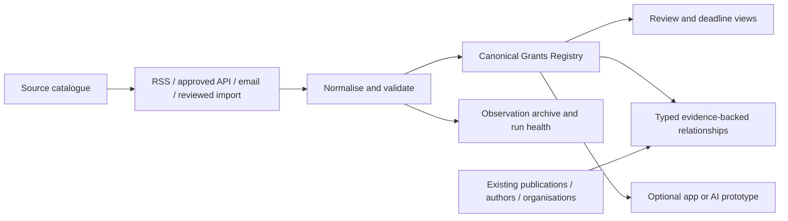

# Grants delivery review and source map

Research date: 2026-09-20. This is a researched implementation proposal, not a deployment receipt. E06 exists; the previously discussed E06-P1–P7 tracks have not been created as individual Conductor tracks. Sources below were identified through official pages; an identified page is not a tested RSS/Atom/API endpoint. Coverage is non-exhaustive.

## Simpler implementation and reuse

Start with one Grants Registry list, a source register (initially configuration), and evidence files in the existing approved archive. Introduce a relationship list only when publication links are delivered. Reuse the publication design's stable keys, review preservation, date uncertainty, archive manifests, UI automation and readback conventions. Keep publication and grants flow identities separate. A single canonical ingestion workflow may have small adapters; it need not be one unmaintainable flow.

Reuse `scripts/grants_registry.py` and `tests/test_grants_registry.py` after hardening. Inspection found key generation occurs before lowercase/link aliases are normalised, partial dates are not calendar-validated, and merged observations retain hashes but not the full changed values. These require regression cases before deployment. RSS/Atom-shaped dictionaries are supported; XML fetching/parsing is not implemented.

Review `scripts/build_sharepoint_upsert_package.py` before adapting it: it changes the trigger to recurrence, hardcodes target identifiers and field mappings, and uses `item()` in top-level upsert actions. Its current string-based validator does not establish that the action graph is executable. Reuse patterns and tests, not an unverified ZIP verbatim. Existing `field_N` names may be legitimate internal names: discover and map them, do not blindly rename columns.

Reuse author and organisation keys only with supported evidence. The current organisation helper includes generic aliases such as Community Health and defaults validity dates to a build date. Correct these before reusing its output as confirmed institutional affiliation. An organisation chart is not a strict facility-below-service tree: services can span facilities. No workforce row data is needed.

Separate Opportunity, Award, and Application identities. An opportunity can lead to awards; publications can acknowledge awards. A topical match between a paper and an opportunity is a recommendation, not evidence of funding. Use relationship types such as `funded_by_award`, `relevant_to_opportunity`, and `investigator_affiliation`, with source, review state and confidence. Exact funder plus award identifiers support confirmed links; similarity supports review candidates only.

Add scheme/round identity; funder versus administering agency; deadline type (EOI, minimum data, internal, final); raw local timestamp and timezone; amount bounds/currency; source-stated and calculated status separately; eligibility conditions; last checked; source health. Preserve archived rounds and changes. Do not make every field mandatory before the first useful release.

## Delivery tranches and proposed tracks

| Tranche | Proposed track | Reviewable outcome and acceptance | Dependency/fallback |
|---|---|---|---|
| 0 | G01 contracts and fixtures | Harden keys, rounds, dates, merge history; test alias-equivalent records, impossible dates, repeated rounds, changed deadlines and review preservation | Local; no tenant dependency |
| 0 | G02 source catalogue | Source ID, authority, URL, access method, coverage, eligibility scope, health, last verification and sample fixture for each source | Manual entry/import available for sources without a verified feed |
| 1 | G03 canonical list and review views | Discover existing objects; additive schema; indexed unique key; create/replay/update readback; Needs Review/Open/Closing/Queensland views | Tenant access and list permissions; local package remains usable if access unavailable |
| 1 | G04 federal and Queensland intake | One controlled cycle for NHMRC/MRFF/ARC/QH and priority Queensland sources; source failures isolated; changed dates retained | Email or reviewed CSV where API/RSS unavailable; no requirement to scrape |
| 2 | G05 university and specialty coverage | JCU/UQ/QUT/Griffith adapters or assisted intake; distinguish internal deadlines and affiliated-applicant rules | Restricted portals affect only that adapter |
| 2 | G06 publication relationships | Evidence-backed award links and separately labelled opportunity relevance; counts unchanged | Works initially with publication keys without author matching |
| 3 | G07 operational acceptance | Two successful cycles, duplicate/concurrency and failure tests, source health, rollback, exact key readback | Scheduling and outgoing notifications retain specific approval requirements |
| 4 | G08 optional app and AI experiments | List-backed app prototype; grounded summaries assessed against fixtures; source links and human review | Preview, AI and premium availability never required for base registry |

For a smaller implementation model, each task should name exact input/output files, one expected behaviour, fixtures, commands, expected result and rollback. Separate read-only discovery, local generation, controlled write and readback tasks. Parallelise source research/adapters with disjoint files; use one coordinator for schema changes and platform writes.

## Source catalogue: discovery evidence and intake proposals

The reviewed source catalogue is now machine-readable at `config/grants-sources.json` and validated by `scripts/grants_sources.py`. It records authority URL, proposed intake route, eligibility scope, last verification date and explicit health state. These are source-discovery/configuration assertions; they do not prove that the listed pages expose a permitted RSS/Atom/API endpoint.

Unless specifically stated, RSS/Atom/API availability is unverified. Automated adapters require endpoint, format, update behaviour and access checks. None of these rows claims an installed collector.

| Source | Official reference | Proposed intake and scope |
|---|---|---|
| GrantConnect | https://www.grants.gov.au/ | Federal opportunity authority; registered notifications candidate. Research fetch returned 403; inspect ordinary authenticated access. Do not confuse with US Grants.gov. |
| NHMRC | https://www.nhmrc.gov.au/funding/calendar | Official calendar; retain minimum-data and final deadlines; bounded HTML candidate adapter now read back 13 rows, all `Needs Review`; reviewed import remains required. |
| MRFF | https://www.health.gov.au/our-work/mrff/grant-opportunities-calendar | Open/forecast/closed calendar; bounded HTML candidate adapter now read back 179 rows after repeated-header suppression, all `Needs Review`; GrantConnect IDs deduplicate across administrators and forecast quarters remain approximate. |
| Queensland Grants Finder | https://www.data.qld.gov.au/dataset/grants-finder | Public CKAN package API verified as metadata-only contribution catalogue; not promoted to an opportunity feed. Follow linked agency sources for actual calls. |
| ARC | https://www.arc.gov.au/funding-research/funding-outcomes/grants-dataset | Public paginated JSON API is verified for awards context; keep it `awards_only` and do not treat it as an open-opportunity calendar. Scheme calendar and administering-organisation eligibility still require assessment. |
| Queensland Health ORI | https://www.health.qld.gov.au/research-reports/research/researchers/grants-support | Clinical research fellowships, capacity building and foundation links; first-release Queensland coverage. |
| QH Health Practitioner Research Scheme | https://www.health.qld.gov.au/hpresearch/html/grants | Separate clinician/health-practitioner eligibility and round records. |
| CHHHS research grants | https://www.cairns-hinterland.health.qld.gov.au/research/start-a-research-project/research-grants-and-support | Local discovery hub; follow through to funder authority and current guidelines. |
| Far North Queensland Hospital Foundation | https://www.fnqhf.org.au/2025/06/06/grants-propel-fnq-innovation/ | Verified awards/news evidence; find current call before classifying anything as open. |
| EMF Queensland | https://emergencyfoundation.org.au/grants/queensland/ | Official scheme/round pages; highly relevant Queensland clinical source. |
| Advance Queensland | https://advance.qld.gov.au/about-advance-queensland/advance-queensland-newsletter | Newsletter explicitly covers funding; program pages provide authority. |
| Cancer Council Queensland | https://cancerqld.org.au/research/our-research-centre/ | Fellowships and clinical-trial support; distinguish active program from open round. |
| Queensland award data | https://www.data.qld.gov.au/dataset/advance-queensland-funding-recipients | Award enrichment only; not an opportunity feed. Dataset API/resource formats need separate testing. |
| Metro North | https://metronorth.health.qld.gov.au/research/support/grants/scrf | Restricted institutional opportunities; keep eligibility visible. |
| Metro South | https://www.metrosouth.health.qld.gov.au/research/research-grants/research-support-scheme | Employment restriction explicitly stated; not automatically CHHHS eligible. |
| JCU | https://www.jcu.edu.au/research-and-innovation-services/grants-and-tenders | Priority university discovery source; confirm current bulletin/export entitlement. |
| UQ | https://research-support.uq.edu.au/node/4696 | Funding table separates internal/external closing dates; deduplicate against funder records. |
| QUT | https://www.qut.edu.au/?a=691532 | Partnership funding discovery; research-office access/exports to investigate. |
| Griffith | https://www.griffith.edu.au/research/research-services/research-grants | Research grants hub; internal opportunities require affiliation review. |
| US Grants.gov, optional | https://grants.gov/connect/rss-feeds and https://www.grants.gov/api/api-guide | Documented RSS and APIs; test foreign-applicant eligibility per opportunity before relevance promotion. |

University coverage is now recorded separately in `config/grants-universities.json` for JCU, UQ, QUT and Griffith. These pages describe research-office support and/or internal deadlines, not automatically permitted feeds. Next discovery backlog, not verified endpoints: UniSC, UniSQ, CQUniversity, Bond, Health Translation Queensland, Tropical Australian Academic Health Centre, relevant hospital foundations, Heart Foundation, Diabetes Australia, MS Australia, Dementia Australia Research Foundation, philanthropic trusts, professional colleges and international schemes accepting Australian applicants. University subscription aggregators may supply permitted exports through existing entitlements; do not assume those entitlements exist.

## Current Power Platform features

- Standard SharePoint and RSS connectors support the base design. RSS does not prove Atom compatibility or historical coverage; test each source. Connector documentation: https://learn.microsoft.com/en-us/connectors/sharepointonline/ and https://learn.microsoft.com/en-us/connectors/rss/
- Microsoft states that September 2026 onward disclosures move from release plans to the AI at Work roadmap. Use https://www.microsoft.com/en-us/microsoft-365/roadmap alongside product documentation; do not assume a 2026 wave 2 page exists. Notice: https://learn.microsoft.com/en-us/power-platform/release-plan/2026wave1/power-automate/
- Power Apps vibe with SharePoint data is explicitly preview. Good candidate for a list-backed triage prototype using existing schemas; no Dataverse migration prerequisite should be inferred. Tenant availability, supported field types and licensing need a spike. https://learn.microsoft.com/en-us/power-apps/vibe/add-data-source-sharepoint-lists
- Vibe can take work content, but that capability has Copilot licensing and protected-file limitations. Bootstrap from a sanitised schema and examples. https://learn.microsoft.com/en-us/power-apps/vibe/create-app-data-plan
- Generative pages are documented for model-driven apps with Dataverse/connectors. Treat as a conditional alternative if the environment already supports it. https://learn.microsoft.com/en-us/power-apps/maker/model-driven-apps/generative-pages
- Power Automate's 2026 plan includes improved management, restore and inventory capabilities. Verify actual availability in the tenant before relying on them. Avoid desktop automation and process-mining dependencies for this registry.
- SharePoint connector documentation includes preview document generation actions, with additional prerequisites for some actions. These could generate opportunity briefs later; existing local DOCX/CSV exports remain the bootstrap path.

## Blockers and delivery rules

No tenant capability or feed payload was tested in this research pass. The confirmed research-access issue was GrantConnect HTTP 403. Unverified dependencies are connector rights/DLP, actual feed availability, subscription exports and preview availability. Isolate each source adapter and provide reviewed imports so these do not block a usable registry. Manual intake does not fulfil unattended-ingestion acceptance. Schedule activation, publishing/sharing and outbound notifications remain separate explicit gates from repository instructions.
