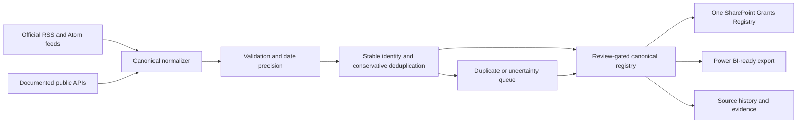

# Grants and funding opportunities system

Scope extension: [RIMS funding pages, institutional dates and subscriptions](RIMS_GRANTS_EXPERIENCE.md) is the current integration design. G01–G08 are now registered in Conductor. The original E06 local MVP remains the foundation; its completion does not cover the new tracks.

Status: **Historical E06 local prototype implemented. Current G01–G08 tracks contain dated isolated native evidence and remaining release/operation gates; neither the local prototype nor old status wording overrides existing user authorisation.**

## MoSCoW requirements — selected module release

Timebox: this module's eventual selected release, not the current publication-foundation MVP. Priority is separate from implementation/native acceptance and tenant authority. See [the canonical MVP and roadmap matrices](../conductor/post-mvp-sequence.md). Existing approved module features remain in scope; new post-MVP expansion/pilots require both MVPs' native and user operational acceptance.

### Must have

- One canonical opportunity schema with many source observations.
- RSS/Atom and API-shaped input normalization.
- Stable source identity, URL, retrieval time, evidence hash, raw dates, and date precision.
- Explicit nullable fields for funder, amount, eligibility, geography, deadline, status, and contact.
- Conservative duplicate detection and idempotent merge.
- Review states for missing, inferred, conflicting, or uncertain data.
- SharePoint-compatible mapping and Power BI-ready exports.

### Should have

- Source health, last-seen, and stale-opportunity indicators.
- Funder taxonomy, opportunity type, discipline, geography, and CHHHS relevance review.
- Deadline reminders as a future approved workflow, never enabled by default.
- API adapters only for documented public APIs that add material coverage or structure.

### Could have

- Saved searches, staff watchlists, and controlled email/Teams notifications.
- Matching against research themes, facilities, investigators, and prior grants.
- Historical snapshots of changed amounts, deadlines, and eligibility.

### Won't have in the first release

- Automated applications or eligibility decisions.
- Scraping sources that prohibit automated access.
- A claim that the feed set is a complete funding census.
- Multiple competing SharePoint lists or platform flows for the same registry.

## Canonical schema

The local implementation is `scripts/grants_registry.py`. Its canonical fields are:

`OpportunityKey`, `Title`, `Funder`, `Source`, `SourceID`, `RoundID`, `URL`, optional `SourceRowURL`, `Description`, `Eligibility`, `Geography`, `Amount`, `Deadline`, `DeadlineRaw`, `DeadlineTimezone`, `DeadlineLocalTime`, `DeadlineUTCInstant`, `DeadlineBrisbaneDate`, `DeadlineBrisbaneTime`, `DeadlineTemporalStatus`, `DeadlinePrecision`, `Status`, `Contact`, `CHHHSRelevance`, `ReviewStatus`, `ReviewNotes`, `RetrievedUTC`, `RetrievedTimestampStatus`, `EvidenceHash`, and `SourceObservations`. `URL` is the canonical opportunity destination; `SourceRowURL` preserves a distinct source listing row/anchor when supplied and does not participate in identity. Observation timestamps without an explicit timezone remain `Needs Review`; deadlines preserve the source value, resolve only documented timezones, and expose a separate Brisbane view only when an instant is determinable. Conflicting timezone aliases are flagged rather than resolved by precedence. Naive local date/time text is retained for review without a fabricated instant. Date-only and partial values do not gain invented times.

`OpportunityKey` preserves the existing `GRANT:` hash for delimiter-free source identities. If `Source`, `SourceID` or `RoundID` contains `:` or `|`, the normalizer uses a JSON-encoded identity tuple under the distinct `GRANTX:` prefix so separator characters cannot make different source records alias. Before any native reviewed import, reconcile existing rows containing those characters against the new key; never silently rekey a tenant record.

## Mermaid architecture

## Canonical platform rule

The platform should have one `Grants Registry` list and one canonical ingestion flow. New sources add source observations to that registry; they do not create parallel lists or duplicate flows. Any future live deployment must inspect existing platform objects, update in place where appropriate, and verify readback before declaring the system canonical.

### Connector boundary: SharePoint list versus OneDrive archive

The grants registry is a structured-list workload. Its canonical cloud flow must use the **SharePoint Online** connector and target the single `Grants Registry` list by its resolved site and list IDs. It must not use OneDrive file actions for registry writes.

OneDrive remains valid only for the separate source-archive/readback contract used by the existing publication validation flow. That flow is not the grants registry flow and must not be repurposed as the list upsert flow. The existing publication upsert flow is also a separate canonical object targeting the Publication Registry list.

Accordingly, the live deployment gate is:

1. resolve whether a `Grants Registry` list already exists;
2. if it exists, inspect and update that object in place;
3. if it does not exist, create exactly one list after the approved platform gate;
4. configure exactly one SharePoint-based ingestion flow against that list; and
5. prove a list create/update/readback with a non-production test record before any production scheduling or notifications.

No live list, flow, schedule, notification, sharing change, or Power BI object is created by the local MVP.
