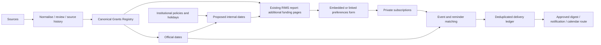

# CHHHS RIMS grants extension

User-authorised scope: extend the existing RIMS report with funding pages. Preserve existing publication pages, measures, filters and canonical keys. Earlier three-page publication scope is the publication baseline, not a limit on this separately requested extension. Existing dashboard and frozen validation contracts disagree about page count; inventory actual report pages before updating generated report definitions and acceptance baselines. This document does not claim native page deployment.

## MoSCoW

- Must: canonical opportunities with rounds and provenance; funder dates distinct from institutional dates; accurate precision/timezones; configurable institutional policy; individual-grant, category and funder subscriptions; unsubscribe/pause; personal access enforcement; existing RIMS navigation; no duplication of publication counts.
- Should: changes/cancellations, digest preferences, deadline reminders, calendar subscription, source health, historical versions, review-preserving corrections and award/publication links.
- Could: Power Apps vibe prototype, AI summaries and relevance suggestions with source citations; university/specialty expansion.
- Won't initially: auto-applications, automatic eligibility decisions, inferred funding relationships or obligatory premium/preview infrastructure.

## Additional report pages

| Page | Contents | User actions |
|---|---|---|
| Funding Opportunities | Search; Queensland/applicant eligibility; funder/category/round/status; amount; authoritative link; last verified; next institutional and external deadlines | Open detail, follow opportunity, follow category or funder |
| Funding Calendar | Agenda plus date grid/matrix; distinguish external final, EOI, minimum data and institutional review dates; overdue/stale/uncertain states | Filter dates, open opportunity, request calendar subscription/export |
| My Funding Watchlist | Authenticated user's follows, matched opportunities, deadlines and change summaries | Edit preferences, pause, unsubscribe |

Use standard visuals initially; a paid calendar visual is unnecessary. Report slicers are temporary exploration state; explicit Subscribe actions persist preferences. Use an embedded Power Apps visual if available, or a link to the same canonical preference form. Power BI report-email subscriptions do not implement grant-event subscriptions. Power Apps readback confirms saved preferences immediately; imported report tables may remain stale until refresh. Do not promise instant model refresh.

## Data model and platform fields

| Entity | Minimum contract |
|---|---|
| Opportunity | OpportunityKey, FunderKey, SchemeKey, RoundID, title, source URL, status, eligibility, category links, evidence and review state |
| Deadline | DeadlineKey, OpportunityKey, Kind, SourceRaw, LocalDate, LocalTime, Timezone, UTCInstant when known, Precision, SourceURL, Revision, Cancelled |
| Institutional policy | PolicyKey, Version, OrganisationKey, AnchorKind, LeadDays, CalendarOrBusinessDays, HolidayCalendarVersion, EffectiveFrom/To, review state |
| Institutional deadline | DeadlineKey, AnchorDeadlineKey, PolicyKey/Version, CalculatedDate, OverrideDate, OverrideReason, reviewed status, stale flag |
| Subscription | SubscriptionKey, authenticated UserKey, Scope (opportunity/category/funder), TargetKey, Active, EventTypes, reminder offsets, digest cadence, channel, timezone |
| Calendar change ledger | ChangeKey, DeadlineKey, OpportunityKey, previous/current revision and date, cancellation state, source URL, observed time, review state |
| Delivery ledger | UserKey, EventKey, deadline/source revision, reminder offset, channel, status, attempt time and external event ID |
| Relationship | Typed opportunity/award/publication/author/organisation keys, evidence, confidence, review state |

Create supporting lists only where persistence requires them and reuse suitable existing ones after discovery. Supporting deadline/subscription lists are not duplicate grant registries. Archive detailed source snapshots as files with manifests.

## Institutional dates

Derive proposed internal dates from a selected deadline kind and a versioned policy: for example, ten business days before external final submission. This is an example, not an approved CHHHS policy. Supply Queensland/local holidays explicitly; no automatic claim of holiday coverage. Date-only deadlines stay date-only; month/quarter forecasts cannot yield precise reminders. Keep published funder timezones (including DST) and render a Brisbane view separately.

When the source deadline changes, recalculate derived dates and flag reviewed overrides for attention. Preserve source and previous values. An override needs a reason and never rewrites the official deadline. If there is no applicable policy, show institutional date unknown.

## Subscriptions and calendars

Category subscriptions include newly discovered and reclassified matching grants. Individual subscriptions follow that opportunity round through amendments/closure; following future rounds belongs to a scheme-level extension. Overlapping subscriptions yield one notification per user/event/revision/channel. Read active preferences and permissions again immediately before delivery. Pausing stops reminders; unsubscribing invalidates private feed access when applicable.

Offer digest versus immediate-change preferences, reminder offsets, and event kinds (new, deadline changed, closing, cancelled). Public category calendars can include public opportunity information only. Personal calendars require a supported authenticated or revocable private feed; a one-off ICS download is not a live subscription. Outlook event synchronisation needs stable event IDs, update/cancellation handling and explicit delivery activation. Date-only events use all-day dates, not invented midnight deadlines.

Personal preference access must be enforced by the backing service; a report filter alone is insufficient. Derive UserKey from the signed-in identity, never trust a user-editable recipient field. The local matcher requires the signed-in UserKey and returns only that user as a candidate; it is not a delivery authorization check.

## Architecture and sequencing

G01/G02 establish contracts and source configuration; G03/G04 deliver storage/intake; G05 expands coverage; G06 delivers relationships; G08 builds dates/preferences/pages alongside G03; G07 verifies the integrated result. Preview features are optional G08 experiments. No purchase, publication/sharing, scheduled activation or outgoing message occurs as part of local implementation.

## Local implementation and verification

`scripts/grants_planning.py` implements date-offset and subscription candidate matching reference logic. It does not create events or send mail. `scripts/grants_registry.py` now normalises identity aliases before key calculation, distinguishes supplied rounds, rejects invalid dates and retains complete normalised observation snapshots. Existing keys derived from affected inputs need explicit migration mapping before any backfill. Current-record precedence/review preservation remains a G01 task.

Native acceptance must prove stored policies/preferences, permission isolation between two users, source deadline changes, holidays/DST, duplicate-event suppression, unsubscribe before delivery, calendar updates/cancellations, report page persistence and unchanged publication totals. Existing frozen report manifests are not regenerated merely to accept an unobserved platform change.

References: [Power Apps visual](https://learn.microsoft.com/en-us/power-apps/maker/canvas-apps/powerapps-custom-visual), [Power BI email subscriptions](https://learn.microsoft.com/en-us/power-bi/collaborate-share/end-user-subscribe), [source and feature research](GRANTS_DELIVERY_REVIEW.md).
