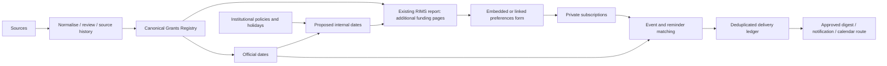

# CHHHS RIMS grants extension

User-authorised scope: extend the existing RIMS report with funding pages. Preserve existing publication pages, measures, filters and canonical keys. Earlier three-page publication scope is the publication baseline, not a limit on this separately requested extension. Existing dashboard and frozen validation contracts disagree about page count; inventory actual report pages before updating generated report definitions and acceptance baselines. This document does not claim native page deployment.

## MoSCoW — selected module release

Timebox: this module's eventual selected release, not the current publication-foundation MVP. Priority is separate from implementation/native acceptance and tenant authority. See [the canonical MVP and roadmap matrices](../conductor/post-mvp-sequence.md). Existing approved module features remain in scope; new post-MVP expansion/pilots require both MVPs' native and user operational acceptance.

- Must: canonical opportunities with rounds and provenance; funder dates distinct from institutional dates; accurate precision/timezones; configurable institutional policy; individual-grant, category and funder subscriptions; unsubscribe/pause; personal access enforcement; existing RIMS navigation; no duplication of publication counts.
- Should: changes/cancellations, digest preferences, deadline reminders, calendar subscription, source health, historical versions, review-preserving corrections and award/publication links.
- Could: Power Apps vibe prototype, AI summaries and relevance suggestions with source citations; university/specialty expansion.
- Won't initially: auto-applications, automatic eligibility decisions, inferred funding relationships or obligatory premium/preview infrastructure.

## Additional report pages

| Page | Contents | User actions |
|---|---|---|
| Funding Opportunities | Search; Queensland/applicant eligibility; funder/category/round/status; amount; authoritative link; last verified; next institutional and external deadlines | Open detail, follow opportunity, follow category or funder |
| Funding Calendar | Agenda plus date grid/matrix; distinguish external final, EOI, minimum data and institutional review dates; overdue/stale/uncertain states | Filter dates, open opportunity, request calendar subscription/export |
| My Funding Watchlist | Authenticated user's follows, matched opportunities, deadlines and change summaries | Edit preferences, pause, unsubscribe |

Use standard visuals initially; a paid calendar visual is unnecessary. Report slicers are temporary exploration state; explicit Subscribe actions persist preferences. Use an embedded Power Apps visual if available, or a link to the same canonical preference form. Power BI report-email subscriptions do not implement grant-event subscriptions. Power Apps readback confirms saved preferences immediately; imported report tables may remain stale until refresh. Do not promise instant model refresh.

## Data model and platform fields

| Entity | Minimum contract |
|---|---|
| Opportunity | OpportunityKey, FunderKey, SchemeKey, RoundID, title, canonical destination URL, optional distinct source-row/anchor URL, status, eligibility, category links, evidence and review state |
| Deadline | DeadlineKey, OpportunityKey, Kind, SourceRaw, LocalDate, LocalTime, Timezone, UTCInstant when known, Precision, SourceURL, Revision, Cancelled |
| Institutional policy | PolicyKey, Version, OrganisationKey, AnchorKind, LeadDays, CalendarOrBusinessDays, HolidayCalendarVersion, HolidayDates, EffectiveFrom/To, review state |
| Institutional deadline | DeadlineKey, AnchorDeadlineKey, PolicyKey/Version, CalculatedDate, OverrideDate, OverrideReason, reviewed status, stale flag; append-only override rows also carry OverrideKey/Revision, anchor value/precision, and RecordedAtUTC |
| Subscription | SubscriptionKey, authenticated UserKey, Scope (opportunity/category/funder), TargetKey, Active, EventTypes, reminder offsets, digest cadence, channel, timezone |
| Delivery ledger | UserKey, EventKey, deadline/source revision, reminder offset, channel, status, attempt time and external event ID |
| Relationship | Typed opportunity/award/publication/author/organisation keys, evidence, confidence, review state |

Create supporting lists only where persistence requires them and reuse suitable existing ones after discovery. Supporting deadline/subscription lists are not duplicate grant registries. Archive detailed source snapshots as files with manifests.

## Institutional dates

Derive proposed internal dates from a selected deadline kind and a versioned policy: for example, ten business days before external final submission. This is an example, not an approved CHHHS policy. A business-day policy must supply unique real ISO `HolidayDates` and a `HolidayCoverage` record bound to the same `CalendarVersion`; that record carries a stable source ID, HTTPS source URL, capture time, explicit coverage interval, `CoverageVerified=true` and the source-evidence SHA-256. A missing or malformed record, version mismatch, date outside the covered interval, or unverified coverage rejects the policy/projection. The hash and flag support reconciliation but do not themselves approve an institutional policy; each generated calendar date remains visibly provisional until authoritative policy and holiday evidence are accepted. Date-only deadlines stay date-only; month/quarter forecasts cannot yield precise reminders. Keep published funder timezones (including DST) and render a Brisbane view separately.

When the source deadline changes, recalculate derived dates and flag reviewed overrides for attention. Preserve source and previous values. An override needs a reason and never rewrites the official deadline. If there is no applicable policy, show institutional date unknown.

Local override reconciliation is append-only: each history revision has a stable
key derived from the exact anchor, policy/version and revision number, and the
complete contiguous revision sequence is required. Each row preserves the
source anchor key/date/precision, calculated date, proposed override date,
reason, review state and recorded timestamp. The current view marks a revision
stale when the source key/date/precision, policy/version or calculated date
changes, the source is cancelled/uncertain, or the policy is not current. It
never applies an override or changes the official deadline. This local
consistency rule does not prove that a reviewer, organisation or tenant has
approved the policy or override, and it does not establish native history
persistence.

The machine-readable record shapes are maintained in
`contracts/g08-institutional-date-policy.schema.json` and
`contracts/g08-institutional-deadline-override.schema.json`. The runtime
reconciler additionally enforces derived keys, complete contiguous revisions,
timestamp ordering and current-input staleness; JSON Schema validity alone is
not an acceptance decision.

## Subscriptions and calendars

Category subscriptions include newly discovered and reclassified matching grants. Individual subscriptions follow that opportunity round through amendments/closure; following future rounds belongs to a scheme-level extension. Overlapping subscriptions yield one notification per user/event/revision/channel. Read active preferences and permissions again immediately before delivery. Pausing stops reminders; unsubscribing invalidates private feed access when applicable.

Offer digest versus immediate-change preferences, reminder offsets, and event kinds (new, deadline changed, closing, cancelled). Public category calendars can include public opportunity information only. Personal calendars require a supported authenticated or revocable private feed; a one-off ICS download is not a live subscription. Outlook event synchronisation needs stable event IDs, update/cancellation handling and explicit delivery activation. Date-only events use all-day dates, not invented midnight deadlines.

Personal preference access must be enforced by the backing service; a report filter alone is insufficient. Derive UserKey from the signed-in identity, never trust a user-editable recipient field. The local matcher returns candidates only and is not a delivery authorization check.

## Architecture and sequencing

G01/G02 establish contracts and source configuration; G03/G04 deliver storage/intake; G05 expands coverage; G06 delivers relationships; G08 builds dates/preferences/pages alongside G03; G07 verifies the integrated result. Preview features are optional G08 experiments. No purchase, publication/sharing, scheduled activation or outgoing message occurs as part of local implementation.

## Local implementation and verification

`scripts/grants_planning.py` implements date-offset and subscription candidate matching reference logic, while `scripts/grants_calendar.py` produces a local, review-gated iCalendar projection with stable event IDs and explicit cancellation semantics. Neither creates events, subscriptions or mail. `scripts/grants_registry.py` now normalises identity aliases before key calculation, distinguishes supplied rounds, rejects invalid dates and retains complete normalised observation snapshots. Existing keys derived from affected inputs need explicit migration mapping before any backfill. Current-record precedence/review preservation remains a G01 task.

Native acceptance must prove stored policies/preferences, permission isolation between two users, source deadline changes, holidays/DST, duplicate-event suppression, unsubscribe before delivery, calendar updates/cancellations, report page persistence and unchanged publication totals. Existing frozen report manifests are not regenerated merely to accept an unobserved platform change.

References: [Power Apps visual](https://learn.microsoft.com/en-us/power-apps/maker/canvas-apps/powerapps-custom-visual), [Power BI email subscriptions](https://learn.microsoft.com/en-us/power-bi/collaborate-share/end-user-subscribe), [source and feature research](GRANTS_DELIVERY_REVIEW.md).

## Persistent delivery dry-run implementation — 2026-10-04

`scripts/grants_delivery_ledger.py` implements `DryRunLedger` over SQLite using the existing `grants_planning.delivery_event_key` identities. This is disjoint local G08-H04 implementation; it does not satisfy the pending native G08-H02/H03 prerequisites or activate delivery.

`plan` collapses overlapping category/funder/opportunity follows to one recipient/event/revision/channel key. Duplicate planning preserves the existing status. `begin` reserves one attempt transactionally after re-reading the current preferences, explicit access decision and current event revision. Unsubscribe/pause, access loss, a stale revision or cancellation blocks the attempt; imprecise dates do not produce precise reminders. Failed attempts can retry while keeping history. Pending, uncertain and succeeded attempts suppress duplicate reservations across restart and independent ledger connections. Exact attempt/provider readback can reconcile an interrupted or uncertain attempt without sending another event.

`outcome` and `resolve` accept only simulated provider IDs prefixed `SIMULATED:`. All returned inspection/reservation results identify `DryRun=true` and `DeliveryEnabled=false`; database succeeded/failed states describe simulations only. There is no provider client, send operation, schedule, invitation or real recipient configuration. Store any future real preference or recipient dry-run inputs/ledger under ignored private paths.

Thirteen focused synthetic tests passed for overlap, duplicate triggers, restart, unsubscribe, access loss, revisions, cancellation, approximate dates, failed retry history, uncertain responses and exact simulated reconciliation. Native persistence, recipient isolation, provider acceptance and delivery activation remain open under the existing G08 gates.

### Personal-feature implementation checkpoint — 2026-10-05

The existing My Funding Watchlist now returns HTTP 200 for exact list metadata,
fields, roles and complete items through the authenticated browser. This
supersedes the October 3 403 as the current access observation. Native item
count is zero, list permissions are unique, and there is one role assignment.
ReadSecurity and WriteSecurity are both 1. Writable custom fields remain Title,
OpportunityKey, Scope, TargetKey and Active; personal preference fields are not
present. Private inventory and raw evidence:
`private/ops/2026-10-05-g08-watchlist-native-inventory-private.json` and
`private/ops/2026-10-05-g08-watchlist-inventory-summary-private.json`.
No schema, sharing or permissions were changed. This closes the exact read
blocker only; native preference persistence and two-user isolation remain open.

Supported identity design uses the authenticated service identity, never a
caller-supplied UserKey or recipient. SharePoint exposes current user identity
through its Web object ([Microsoft identity documentation](https://learn.microsoft.com/en-us/sharepoint/dev/sp-add-ins/get-user-identity-and-properties-in-sharepoint)).
A site-scoped SharePoint identity must remain scoped to that site; it is not
an assumed tenant-wide person key. A privileged flow connection writing every
item as its owner cannot establish creator-based user isolation. List managers
can read/edit every item ([Microsoft list permissions](https://support.microsoft.com/en-us/sharepoint/lists/get-started-with-sharepoint/introduction-to-lists));
owner-only success cannot demonstrate two ordinary users' isolation. Reuse
requires supported delegated identity, exact backing-service enforcement and
separate cross-user read/write attempts. No users, assignments or invitations
were created to manufacture that evidence.

Relationship contracts retain typed award/publication/opportunity/affiliation
keys and candidate confidence until independently backed by authoritative
identity evidence. AwardID alone does not disambiguate funders. Existing date
policies require explicit version, organisation, anchor, lead-day units and
coverage; unknown lead time yields no derived date. Existing institutional
policy discrepancies are not resolved by guessing or treating source guidance
as CHHHS eligibility. Local history and calendar code do not establish native
policy persistence or a revocable personal subscription.

Dry-run ledger correction: canonical Status Cancelled, Canceled or Withdrawn
now blocks pending change events and precise reminders, matching the explicit
Cancelled flag. Cancellation events remain eligible for simulation with current
access and active preferences. Regression fails before the fix and passes after;
14 focused ledger tests pass. Event/attempt history is retained; delivery remains
disabled. Native ledger persistence, watchlist save/reload, relationship replay,
calendar-client cancellation and cross-user isolation are still acceptance gates.

Conductor review for G06/G08: partial plan compliance; focused regression and
existing ledger suite passed, scoped diff whitespace check passed. No broad
suite repeated, no outbound messages and no native personal-feature write.
