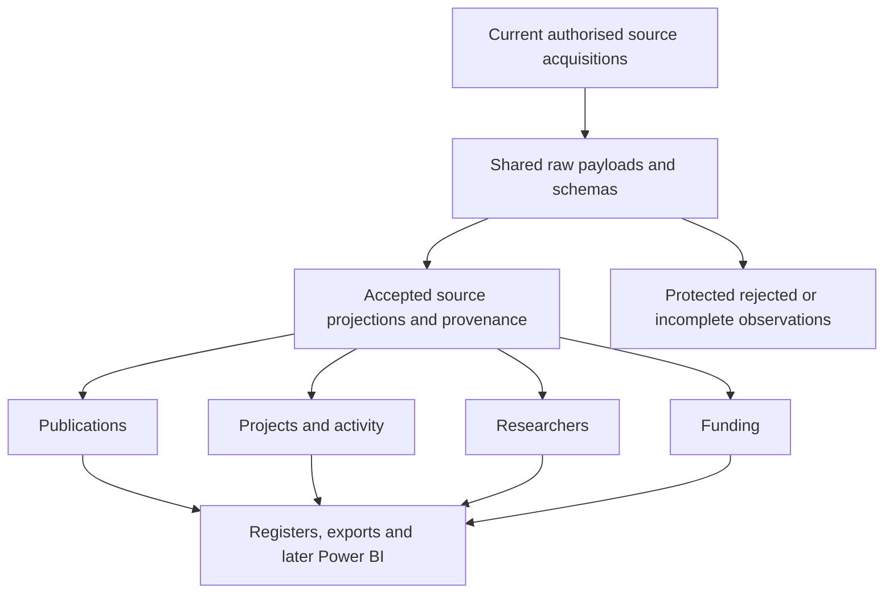
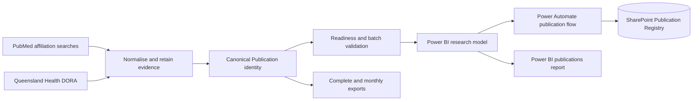
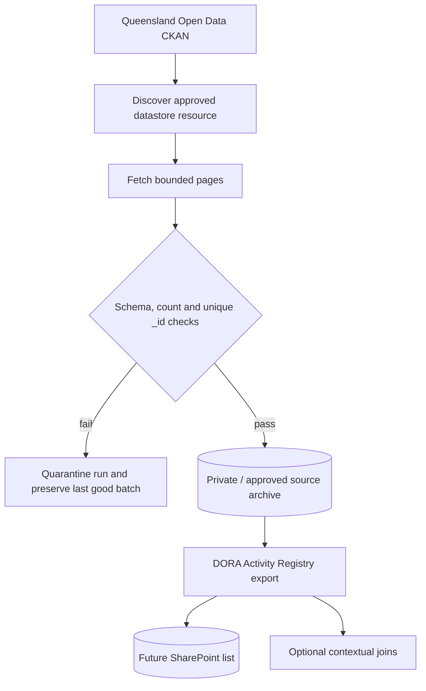
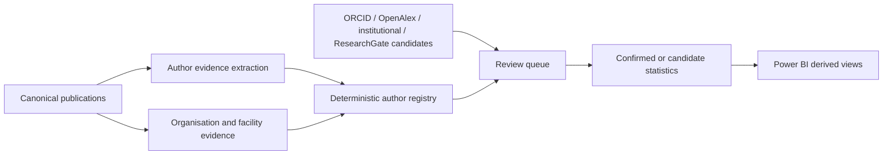
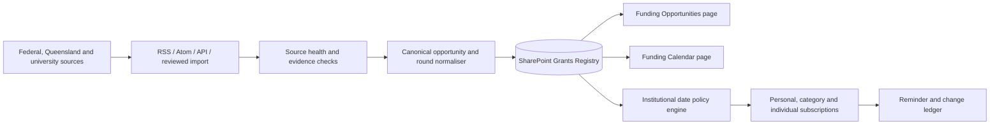
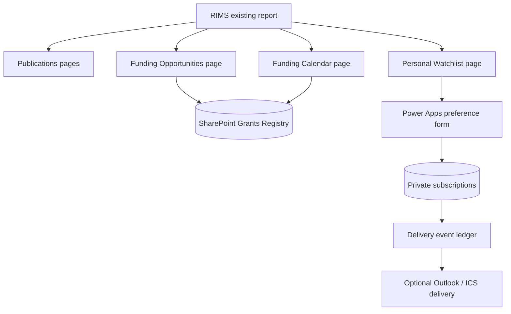
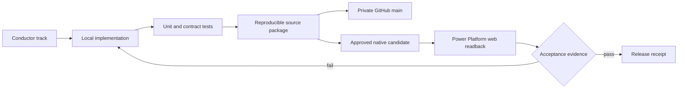

# RIMS module requirements and design summary

## Horizontal and vertical schema — 13 October 2026

Current direction: retain every returned field from each current authorised
source before subject projection. Shared acquisition, paging, immutable raw
storage, provenance, freshness and replay support Publications, Projects/Activity,
Researchers and Funding. Normalisation retains original values and uncertainty;
registers, exports and Power BI consume accepted subject projections.

Implement through existing T11/E01 tasks and the current archive flow; the
[shared-data delivery contract](PLATFORM_COMPLETION_PLAN.md#shared-data-delivery-contract--13-october-2026)
contains bootstrap choices, source coverage, permissions, tool routes,
troubleshooting and acceptance. Historical module snapshots below are dated
observations, not all-source retention or current permission proof.

This is a concise orientation for the modules designed so far. It separates
the intended Microsoft Power Platform design from what has actually been
proved locally or in the tenant. Local tests and generated definitions do not
certify live Power BI, SharePoint, Power Automate, permissions, refresh or
delivery acceptance.

Current access scope: implementation and acceptance are limited to the
authenticated user's existing access, isolated personal DEV objects and manual
operation, matching the publications development pattern. Shared access,
cross-user delivery and unattended recurrence are future extensions.

## 1. Publications registry

Requirements: collect PubMed affiliation results and Queensland Health DORA
records; preserve raw source fields and date precision; deduplicate only with
strong identifier evidence; retain ambiguous and excluded records for review;
provide a complete canonical register plus monthly exports; enrich with
clinical, open-access, trial, funding and organisation evidence without
inventing institutional attribution.

Design: PubMed and DORA source observations are normalised into a canonical
`Publication` model. A SharePoint `Publication Registry` is the durable list
target. The single canonical Power Automate flow reads the model, checks source
readiness, projects publication rows, and serially creates or updates list
items by `SourceKey`. The current Power BI report is the presentation surface.
Authenticated readback on 2026-09-22 shows six pages: the four
publication/analytics pages plus `Funding Opportunities` and `Funding Calendar
& Watchlist`.

Current state: local contracts and tests pass; the canonical tenant flow is
disabled, Flow Checker is clean, and one canonical flow remains. Actual
create/replay/update, duplicate, failed-batch and unattended schedule proof
remain explicit acceptance gates.

## 2. DORA activity registry

Requirements: retain every source column from the Queensland Open Data DORA
activity datastore, preserve source `_id` identity and provenance, reject page
loss, schema drift, count mismatch and duplicate source IDs, and keep project /
activity data distinct from the DORA publication repository.

Design: a CKAN package/resource discovery step selects the datastore resource;
the paged collector validates each response; an additive RIMS export maps the
retained rows to a future `DORA Activity Registry` SharePoint list. Activity
records can provide context for publications and grants but must not silently
become publication rows.

Current state: the collector and schema are implemented and the complete
public source was read locally. Native list creation and readback remain open.

## 3. Author and organisation enrichment

Requirements: derive author-centred statistics from publication evidence,
preserve name variants and co-author context, distinguish confirmed affiliation
from candidate matching, and expose organisation hierarchy and validity
evidence without claiming a complete author census. ResearchGate, ORCID,
OpenAlex and institutional pages are candidate evidence sources, not automatic
identity proof.

Design: the registry is a derived view over canonical publications, author
evidence and organisation-reference data. Exact source statements and
confidence/review fields are retained. A later list or model projection may
materialise statistics, but the publication registry remains the source of
truth. Grant/publication links use a separate typed relationship bridge and
must not inflate publication rows.

Current state: local implementation and tests exist. Native columns, reviewed
backfill and tenant readback are not yet accepted.

## 4. Grants and funding opportunities

Requirements: capture opportunities, rounds, funders, source observations,
external deadlines and uncertain date precision; distinguish opportunities,
awards and applications; include NHMRC, MRFF, ARC and Queensland sources plus
university discovery; support institutional dates, categories, funders and
individual-grant subscriptions; preserve revisions, cancellations and source
health.

Design: one canonical `Grants Registry` SharePoint list uses `OpportunityKey`
as its only opportunity identity. RSS/Atom/API-shaped adapters and reviewed
imports feed a fail-closed normaliser; the ARC public API is retained as an
explicit awards-only route and cannot be promoted to an opportunity row. The local PBIP now includes additive Funding
Opportunities, Funding Calendar and My Funding Watchlist pages over an
empty-safe model table. Institutional deadline policies, subscription
preferences and delivery events are separate typed entities; they do not
duplicate the registry. Grants pages are additive pages in the existing RIMS
Power BI report, with Power Apps or another standard form for persistence where
report slicers alone are insufficient.

Current state: local G01–G08 contracts, source catalogue, adapters, planning,
review-gated iCalendar projection, relationship and delivery-policy tests exist.
The calendar projection derives institutional all-day dates only from exact
source deadlines, preserves the external deadline, and emits stable tentative
or cancelled events without creating subscriptions. An isolated personal DEV
`Grants Registry` list and the SharePoint-only reviewed-import flow have been
created and read back. A controlled authenticated replay proved one synthetic
create and one same-key update, with the flow restored Off; the synthetic row
still requires cleanup confirmation. Current-user native report pages and
personal subscription persistence remain unaccepted; shared targets,
cross-user notifications and unattended delivery are future extensions. The
three local grants page definitions are not tenant readback.

## 5. RIMS dashboard and user experience

Requirements: keep the existing publication pages stable; add funding
opportunities, funding calendar and personal watchlist pages; show source
health, review status, external versus institutional dates, stale/uncertain
states and links back to authoritative sources; enforce personal access for
subscriptions; avoid duplicating publication counts or creating parallel
registries.

Design: Power BI remains the shared analytical surface. SharePoint provides
structured persistence and version history. Power Apps is the preferred
standard interaction surface for explicit save/pause/unsubscribe actions if a
report-only experience cannot provide reliable persistence. Outlook/ICS
delivery is downstream of a tested event ledger and explicit activation.

## 6. Platform operations, versioning and CI/CD

Requirements: keep one source-only canonical GitHub `main`, pin Conductor,
separate local/source evidence from tenant receipts, package reproducibly,
validate with Microsoft Power Platform tooling where applicable, and never
turn local green tests into a live acceptance claim.

Design: Git and Conductor plans are the source and work ledger. Build Tools,
PAC, Azure CLI, PowerShell and GitHub CLI are local preflight tools; solution
deployment and `powerplatform-actions` remain conditional on an isolated
Dataverse solution route. PowerApps Test Engine is not adopted for this
PBIP/SharePoint surface. Native browser readback remains the acceptance path.

The current remote branch is source-only. Current-user native
report/model/list/flow acceptance and manual readback remain separate gates and
must be recorded in ignored private receipts. Schedule activation, sharing and
outbound delivery are future extensions.
